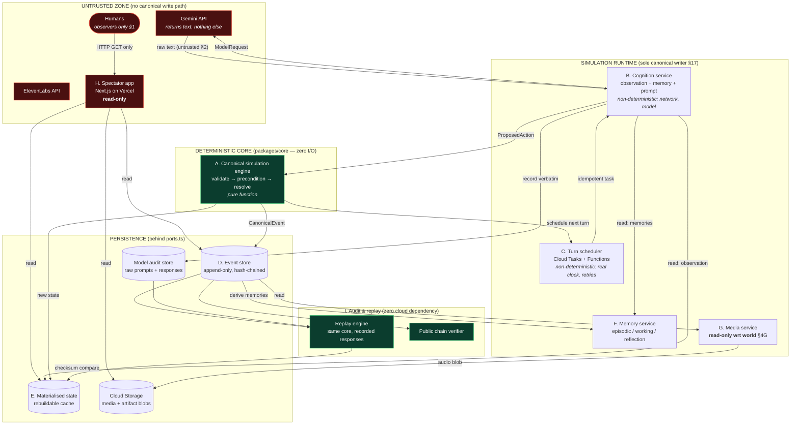
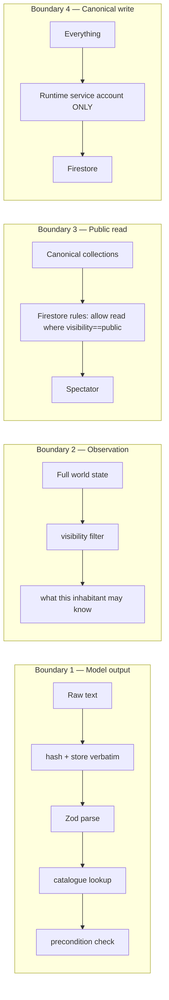

# Architecture

**Status of this document:** Designed. It describes the target architecture of §4 and marks
precisely which parts exist in code today.

**Scope:** the nine components of §4, the data flow between them, the trust boundaries, and the
exact location of the deterministic/non-deterministic line.

---

## 1. The one-sentence architecture

> The LLM proposes intentions. The deterministic world engine decides reality. (§2)

Everything below is a consequence of that sentence. The architecture's job is to make it
*structurally* true rather than merely a policy — the model is not asked to behave, it is placed
somewhere it cannot misbehave from.

---

## 2. Component map



### Legend of the two coloured zones

- **Green (deterministic):** given the same inputs, produces byte-identical output on any machine,
  forever. No clock, no network, no `Math.random`, no floating point.
- **Red (untrusted):** everything here is treated as hostile input or as a pure observer. Nothing in
  the red zone can cause a canonical write.

---

## 3. The nine components

### A. Canonical simulation engine — `packages/core/src/engine/` (**Not started**)

The authoritative rules engine. Signature-level contract:

```
resolve(state, proposedAction, context) -> { events, nextState }
```

It is a **pure function**. It performs no I/O — that is enforced structurally by `ports.ts`, which
holds every interface that touches the outside world, and by the fact that `engine/` may not import
anything but `schema/`, `util/` and `time.ts`.

The engine is the only place that may:
- decide whether an action's preconditions hold,
- draw from an RNG stream,
- mint an entity id,
- construct a `CanonicalEvent`.

Contract pieces that exist today: `event.ts`, `ids.ts`, `time.ts`, `schema/primitives.ts`,
`schema/action-spec.ts`, `util/{canonical,hash,rng}.ts` — all **Implemented**. The resolvers
themselves and the payload schemas in `schema/actions/` are **Not started**.

### B. Cognition service — `packages/cognition/` (**Not started**)

Builds one inhabitant's *legally available* observation (§14.4), retrieves authorised memories
(§14.5), renders a prompt, calls the provider behind `ModelProvider` (`ports.ts`, **Implemented**),
and returns one `ProposedAction`.

Three properties matter:

1. **It cannot write.** `ModelProvider.generate` returns a `ModelResponse` — text and token counts.
   There is no persistence method reachable from cognition. (§2, `ports.ts` header comment.)
2. **It is provider-neutral** (§3). Three implementations are planned: Gemini, a deterministic
   scripted provider for mechanical simulation (§24), and a *replay* provider that serves recorded
   text from `ModelAuditStore.get()` instead of calling anything.
3. **Its output is untrusted.** The raw text is hashed and stored *before* parsing (§14.8), then
   validated against `ProposedActionSchema` plus the per-action payload schema. Two invalid
   responses in a row become a no-op event (§14.10–11), never a retry loop.

### C. Turn scheduler — `packages/runtime/` (**Initial implementation complete**)

Cloud Tasks issues one task per eligible turn. Each carries an idempotency key derived from
`(worldId, inhabitantId, turnNumber)`. `IdempotencyStore.claim()` (`ports.ts`, **Implemented**
interface) returns `false` for a duplicate delivery, and the worker then *abandons* the turn rather
than redoing it — Cloud Tasks guarantees at-least-once, so this is the mechanism behind §15 "each
task can commit at most once".

The scheduler is non-deterministic by nature (real clocks, retry timing, queue ordering). It is
therefore excluded from replay entirely: replay reads the committed event sequence and does not
consult the scheduler at all.

### D. Event store — `ports.ts` `EventStore` (**Implemented** as interface; adapters **Not started**)

Append-only, hash-chained (§16). The interface has no `update` and no `delete`, deliberately:

> "an implementation cannot be asked to rewrite history because no caller can express the request."
> — `ports.ts`

`append(event, expectedSequence)` is the world's optimistic-concurrency primitive. See
[firestore-design.md](./firestore-design.md) §5 for how it maps to a Firestore transaction.

Chain verification is **Implemented**: `verifyChain()` in `event.ts` checks bad hashes, broken
links, non-monotonic sequences, backwards `simTime`, checksum discontinuity and world mismatch.

### E. Materialised world state — `ports.ts` `StateStore<TState>` (**Implemented** as interface)

A cache. It can be deleted and rebuilt from the event log at any time. Nothing may be true of the
world that is only true in materialised state.

`save()` must be atomic with respect to the event append that produced it — in Firestore both are
writes in the same transaction.

### F. Memory service — `packages/core` + `packages/runtime` (**Not started**)

Three tiers (§19): recent working memory, episodic memory, long-term reflections. Two hard rules:

- Reflections are **beliefs, not canonical facts**. They live outside the event log's authority.
- History is never silently rewritten. A changed belief creates a *new* memory record (§19).

Memory derivation from events is deterministic (it is a fold over the event log). Reflection
*generation* uses the model and is therefore recorded like any other cognition, with its request and
response hashed into the audit store.

### G. Media service — `packages/runtime` (**Not started**)

ElevenLabs audio for selected events only (§21). **Read-only with respect to the world** (§4G). It
subscribes to committed events, produces a blob in Cloud Storage, and writes a media-index record in
a collection that materialised state never reads. A failed audio job must never block or change the
simulation (§21).

### H. Spectator application — `apps/spectator/` (**Not started**)

Next.js on Vercel. Reads materialised state, the event log (public-visibility events only) and media
blobs. It is deployed to a Vercel project that has **no service-account credential of any kind**
(§17). See [threat-model.md](./threat-model.md) T-5.

### I. Audit and replay service — `packages/audit/` (**Not started**)

Two distinct capabilities:

1. **Chain verification** — structural. Anyone can run `verifyChain()` over an exported log with no
   credentials and no network. Already implemented as a function.
2. **State replay** — semantic. Re-runs the deterministic core over the recorded event inputs and
   the recorded model responses, then compares the reconstructed checksum against production
   (§28). Requires the model audit export but **no cloud dependency**: the replay `ModelProvider`
   serves text from a file.

---

## 4. Where exactly the deterministic line falls

This is the most important boundary in the system, so it is worth being unambiguous.

| Concern | Side | Why |
|---|---|---|
| Action validation, preconditions, resolution | **Deterministic** | It is the world's physics |
| Probability draws (treatment, unauthorised transfer, traits) | **Deterministic** | `Rng.derive(worldSeed, ...purpose)` — seeded, per-purpose streams |
| Entity id minting | **Deterministic** | `deriveId(kind, worldId, sequence, discriminator)` — never `randomUUID` |
| Simulated time arithmetic | **Deterministic** | Integer minutes since Genesis |
| Map generation | **Deterministic** | Function of the published Genesis seed (§5) |
| Observation construction | **Deterministic** | A pure projection of state + visibility |
| Memory *retrieval* scoring | **Deterministic** | Integer scoring over recorded memories |
| — — — | — — — | — — — |
| The model call itself | **Non-deterministic** | Hosted LLM; not bit-reproducible even at temperature 0 |
| Retry timing, queue ordering | **Non-deterministic** | Infrastructure |
| `realTimestamp` on events | **Non-deterministic** | Forensic only; **no rule may read it** (`time.ts`) |
| Audio generation | **Non-deterministic** | And irrelevant — it cannot touch the world |

The line is crossed exactly once per turn, in one direction: raw model text enters, is hashed and
stored verbatim, is parsed, and from that instant onwards everything is deterministic.

**This is why replay works.** Replay does not re-call the model. It reads the *recorded* response
out of `ModelAuditStore`, feeds it through the identical parse-and-resolve path, and must arrive at
the identical checksum. `ports.ts` states this outright in the `ModelRequest.temperature` comment:

> "even at 0 no hosted LLM is bit-reproducible, which is exactly why replay uses the *recorded*
> response rather than re-calling the model (§16)."

### The floating-point ban

`canonicalJson` throws `NonCanonicalValueError` on any number that is not a safe integer. This is
not a style preference — IEEE 754 accumulation order and platform math libraries vary in ways that
silently break replay. Every world quantity is an integer in its smallest unit
(`schema/primitives.ts`), and probabilities are integer numerator/denominator pairs
(`Rng.chance(n, d)`). There is no float anywhere in the canonical path.

### RNG stream derivation

Streams are *derived*, never shared:

```
Rng.derive(worldSeed, "turn", String(sequence), "treatment", patientId)
```

A single global stream would mean that adding one random draw to the treatment resolver shifts every
subsequent number the map generator, the trait generator and the theft resolver see — turning every
rule tweak into a silent constitutional change (§23). Per-purpose derivation makes rule changes
locally scoped.

---

## 5. Trust boundaries



| # | Boundary | Enforced by | Failure mode if it breaks |
|---|---|---|---|
| 1 | Model output → engine | `ProposedActionSchema` + per-action payload Zod + precondition checks | Model dictates reality instead of proposing (§2 violated) |
| 2 | World state → inhabitant observation | `Visibility` discriminated union on every event; observation builder filters on it | §15 "private information cannot appear in another inhabitant's context" violated |
| 3 | Canonical data → public | Firestore security rules, tested (§28) | Private cognition leaks to spectators |
| 4 | Anything → canonical write | Single runtime service account; App Check; no admin credential in frontend | §28 "no human-facing canonical write route exists" violated — Genesis-blocking |

Boundary 2 is enforced *by construction* rather than at read time. Visibility is recorded on the
event itself, so the observation builder filters on a stored field and "cannot see past it"
(`event.ts` comment on `VisibilitySchema`).

---

## 6. One full turn — the 18 steps of §14

```mermaid
sequenceDiagram
  autonumber
  participant T as Cloud Tasks
  participant W as Turn worker (C)
  participant I as IdempotencyStore
  participant S as StateStore (E)
  participant M as Memory service (F)
  participant A as ModelAuditStore
  participant G as Gemini (untrusted)
  participant E as Engine (A, deterministic)
  participant L as EventStore (D)

  T->>W: deliver turn task (at-least-once)
  W->>L: headSequence(worldId)
  Note over W: 1. Reserve world + inhabitant turn number
  W->>I: 2. claim(idempotencyKey, ttl)
  alt already claimed
    I-->>W: false
    W-->>T: ack, abandon turn (no state change)
  else fresh
    I-->>W: true
    W->>S: 3. load state -> preStateChecksum
    W->>S: 4. build legally available observation (visibility filter)
    W->>M: 5. retrieve only authorised memories (budgeted, §19)
    M-->>W: ranked memory set
    W->>A: 6. store + hash complete ModelRequest
    W->>G: 7. generate(request)
    G-->>W: raw text
    W->>A: 8. store + hash untouched raw response
    W->>E: 9. validate against action schema
    alt invalid
      E-->>W: schema error
      W->>G: 10. ONE format-correction request
      G-->>W: raw text (also hashed + stored)
      W->>E: re-validate
      Note over E: 11. second invalid response -> no-op event
    end
    E->>E: 12. validate action preconditions
    E->>E: 13. resolve atomically (pure; RNG derived from seed+sequence)
    E-->>W: events + nextState
    W->>L: 14. append(event, expectedSequence)
    Note over L: rejects if sequence taken<br/>(duplicate worker loses)
    W->>S: 15. save materialised state (same transaction)
    W->>W: 16. postStateChecksum = hashValue(StateChecksum, nextState)
    W->>T: 17. enqueue next eligible turn
    W->>A: 18. record token usage + estimated cost
  end
```

### Notes on specific steps

- **Steps 2 and 14 are two independent duplicate defences.** The idempotency claim is fast and
  cheap; the `expectedSequence` conflict on append is the authoritative one. If the process dies
  between claim and append, the claim TTL expires and the turn is retried safely because the append
  is still guarded by sequence.
- **Steps 6–8 happen before any parsing.** The audit record of what was sent and what came back is
  written *first*, so a crash mid-turn still leaves an auditable trace of the model interaction.
- **Step 10 is a hard limit of one.** Not "retry until valid" — an unbounded correction loop is a
  spend-exhaustion vector (see [threat-model.md](./threat-model.md) T-4).
- **Step 13 must not call anything external.** §18: never call Gemini, ElevenLabs or any other
  side-effecting service from inside a Firestore transaction.
- **Model unavailability reschedules the turn** (§14) — it must not produce a *different* state
  transition. A failed model call is not a no-op action; it is a turn that did not happen.

---

## 7. Serialisation constraint (a real consequence, stated plainly)

`verifyChain()` requires `event.preStateChecksum === prev.postStateChecksum` for every consecutive
pair. Combined with §14.3 (capture pre-turn checksum) and §14.16 (compute post-turn checksum), this
means **canonical events for one world are strictly serialised**: a turn that reads state at
sequence *n* can only commit at sequence *n+1*.

This is a deliberate trade of throughput for auditability. Two workers may run cognition
concurrently (the expensive, slow part), but only one can win the append; the loser must re-run
resolution against the new head or be rescheduled. The world's canonical write rate is therefore
capped at one event at a time.

At the scale this world operates at (see [cost-control.md](./cost-control.md) — tens to low hundreds
of turns per hour), this is not a bottleneck. It would become one above roughly a few events per
second, which is far beyond any configuration the spend ceiling permits.

---

## 8. Deployment topology

| Environment | Firebase project | Purpose | Canonical writer |
|---|---|---|---|
| `dev` | separate | Local + CI, in-memory/file adapters | Developer |
| `staging` | separate | Integration, real Firestore, fake model provider | Staging SA |
| `rehearsal` | separate | §24 accelerated civilisation + 14-day dress rehearsal | Rehearsal SA |
| `production` | separate | The world | **One** runtime SA, rotated, in Secret Manager |

§17 requires all four to be distinct projects. Cross-project credential reuse is a
Genesis-blocking defect.

The spectator Vercel project holds only the Firebase *public web config* (project id, API key,
bucket id) — values that are public by design and are useless without permissive rules. It holds no
service account. See [threat-model.md](./threat-model.md) T-5.

---

## 9. Judgement calls

These are places where §4 is ambiguous or silent and this document has chosen an interpretation.

1. **Where memory derivation lives.** §4F describes the memory service as a separate component, but
   memory content is derived from events and must replay identically. Choice: *derivation* is
   deterministic and lives in core; *storage and retrieval infrastructure* lives in the runtime;
   *reflection generation* is cognition and is audited like any model call. The spec does not say
   this explicitly.

2. **Whether observation construction is in the engine or the cognition service.** §14 places
   "build observation" (step 4) before the engine is involved. Choice: the *function* is
   deterministic and lives in core so replay can verify it; the cognition service *calls* it. If it
   lived in cognition it could drift and no test would catch a leak.

3. **Serialisation of canonical writes** (§7 above). The spec never states whether turns may commit
   concurrently. The checksum chain in the already-written `event.ts` forces strict serialisation.
   This is a decision that has effectively already been made in code, and this document records it
   rather than pretending it is open.

4. **`schema/action-spec.ts` is not exported from `packages/core/src/index.ts`.** As of this
   writing `index.ts` exports `schema/primitives.js` but not `schema/action-spec.js`. Consumers must
   import the deep path. Flagged, not fixed — this document does not own source files.

5. **§12 lists images, designs and visual works as artifacts, and §9 lists "Visual creation" as a
   skill — but §3 and §4G provide no image generation service.** Interpretation adopted here:
   visual artifacts are canonical *records* (creator, title, provenance, ownership, revision
   history) with a textual description; no pixels are generated at v1. This is a genuine gap in the
   spec, recorded here and in [world-rules-v1.md](./world-rules-v1.md).

---

## 10. Related documents

- [threat-model.md](./threat-model.md) — what attacks these boundaries are meant to stop
- [firestore-design.md](./firestore-design.md) — how D and E are actually stored
- [schemas.md](./schemas.md) — the concrete shapes crossing every arrow above
- [state-machines.md](./state-machines.md) — lifecycle diagrams
- [testing-strategy.md](./testing-strategy.md) — how each boundary is proven
