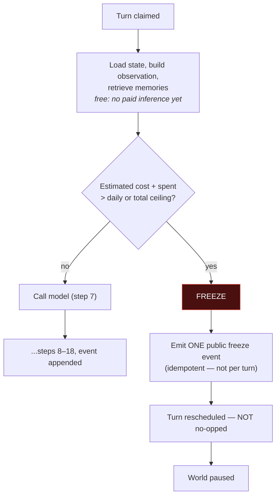

# Cost control

> **Pricing checkpoint — verified 2026-07-28:** the opt-in local Gemini
> composition currently accepts only `gemini-3.5-flash-lite`, with an explicit
> table of $0.30 per million input tokens and $2.50 per million output tokens.
> Pricing carries a verification date and must be checked again against the
> official Gemini pricing page before production or any model change.

**Status:** Partly implemented. `SpendLimitExceededError` (`packages/core/src/ports.ts`),
`packages/cognition/src/budget.ts`, `packages/cognition/src/memory.ts` and
`packages/cognition/src/prompt.ts` exist. The ceiling *ladder* (§6) is not yet enforced end to end,
there is no per-world spend ledger, and no turn has ever been run against a real provider — so no
figure in this document has been validated against a bill.

### Measured reality at time of writing

| Fact | Value | How verified |
|---|---|---|
| Test suite | **252 tests: 250 passing, 2 failing** | `npx vitest run` |
| Failing tests | Both in `packages/core/src/engine/observation.test.ts` — one is a §15 leakage test | See [threat-model.md](./threat-model.md) T-8 |
| Map | 32 × 32 = 1,024 tiles, deterministic from seed | `packages/core/src/engine/mapgen.ts`, 16 passing tests |
| Repository | `github.com/sidevworks/after-genesis`, **private**, CI gates on `gitleaks` before typecheck/test/build | `.github/workflows/ci.yml` |
| Turns executed against a real model | **Zero** | No runtime package exists (`packages/runtime/src/` is empty) |

**Turn cost is dominated by prompt tokens** — the observation and the retrieved memory set — not by
output tokens, not by infrastructure. That is the measured shape of the problem and it determines
where optimisation effort belongs: §4 (observation budget) and §5 (retrieval budget) are the levers
that matter; everything else is rounding.

> ## ⚠ Prices in this document are ILLUSTRATIVE PLACEHOLDERS
>
> Every per-token and per-operation price below is a round placeholder chosen to make the arithmetic
> legible. **They are not quoted from any provider's price list and must not be treated as such.**
>
> Provider pricing changes, varies by region and tier, and differs between model versions.
> **Verifying current Gemini, Firestore, Cloud Functions, Cloud Tasks, Cloud Storage and ElevenLabs
> pricing, and re-running every calculation here with the verified figures, is a prerequisite for
> Genesis.** Until that is done, the ceilings in [world-rules-v1.md](./world-rules-v1.md) — including
> the population ceiling, which is derived from this model — are provisional.
>
> The *structure* of the model is the deliverable. The numbers are placeholders in it.

---

## 1. Why cost is a safety property, not a business concern

§26 ranks cost control 8th of 10 priorities — above spectator experience, below auditability. That
ranking understates it, for one reason: **an uncontrolled budget is an availability failure with
permanent consequences.**

A world that exhausts its budget does not degrade. It stops. And because §23 forbids quietly
repairing a world, and §22 forbids resetting a live world under the same identity, a world that
stops because nobody modelled its cost is a world that may simply end. Spend control is therefore
part of the world's survival, not part of its accounting.

It is also the failure mode with the highest likelihood in the entire
[threat-model.md](./threat-model.md) — T-4 needs no adversary. Population growth and context growth
produce it on their own.

---

## 2. Token cost model per turn

### 2.1 Where the input tokens go

For a `routine` cognition turn (the default, ~90% of turns):

| Prompt region | Tokens | Notes |
|---|---:|---|
| System prompt: world rules summary, physics, constraints | 1,400 | Fixed. Constitutional (§23 — modifying prompts is a constitutional change) |
| System prompt: action catalogue — 60 actions, names + one-line descriptions | 900 | Fixed. `ActionSpec.description` is what appears here |
| Response schema / JSON contract | 400 | Fixed |
| Inhabitant self-state: traits, values, private goals, needs, inventory, skills, activity, health | 600 | Bounded by the inhabitant schema |
| Observation: nearby tiles, visible inhabitants, structures, local public events | 1,200 | **Bounded by the observation budget** (§4) |
| Retrieved memories: 8 at `routine` level × ~60 tokens | 500 | **Bounded by the retrieval budget** (§5) |
| Recent working memory: last few events involving this inhabitant | 300 | Fixed cap |
| Contract/obligation summary, organisation memberships | 200 | Capped |
| **Total input** | **5,500** | |

Output: one `ProposedAction` — `type`, `payload`, and a `rationale` capped at 2000 characters
(**Implemented** cap in `ProposedActionSchema`).

| | Tokens |
|---|---:|
| Structured action JSON | ~100 |
| Rationale (2000 char cap ≈ 500 tokens, typically shorter) | ~300 |
| **Total output** | **400** |

**The three fixed regions total 2,700 tokens — 49% of every prompt.** This is the single largest
lever in the model. Trimming the action catalogue description by 50% would cut ~450 tokens, ~8% of
input cost, from every turn forever. It is also constitutional, so it must be right before Genesis
and cannot be tuned afterwards.

### 2.2 Cost per turn by cognition level

Placeholder rates (**VERIFY BEFORE GENESIS**):

```
Routine tier    (e.g. a Flash-Lite class model):  $0.10 / 1M input,  $0.40 / 1M output
Deliberate tier (e.g. a Flash class model):       $0.30 / 1M input,  $1.20 / 1M output
```

All spend is accounted in **integer micro-dollars** (`micros`, millionths of a dollar). Never
floats — the same reason as everywhere else in this system
([canonical.ts](../packages/core/src/util/canonical.ts) bans them).

| Level | Tier | Input tok | Output tok | Input cost | Output cost | **Total (micros)** |
|---|---|---:|---:|---:|---:|---:|
| `reaction` | routine | 3,800 | 200 | 380 | 80 | **460** |
| `routine` | routine | 5,500 | 400 | 550 | 160 | **710** |
| `conversation` | routine | 5,800 | 500 | 580 | 200 | **780** |
| `planning` | deliberate | 7,200 | 800 | 2,160 | 960 | **3,120** |
| `reflection` | deliberate | 9,000 | 800 | 2,700 | 960 | **3,660** |
| `study` | routine | 6,500 | 400 | 650 | 160 | **810** |

Worked example for `routine`:

```
input:  5,500 tok × $0.10 / 1,000,000 tok = $0.00055 = 550 micros
output:   400 tok × $0.40 / 1,000,000 tok = $0.00016 = 160 micros
                                            total    = 710 micros = $0.00071
```

### 2.3 Blended cost per turn

Assumed level mix, from the world rules' compute costs — deliberate levels are expensive in
`compute` too, so inhabitants cannot use them constantly
([world-rules-v1.md](./world-rules-v1.md) §3.6):

| Level | Share | Micros | Contribution |
|---|---:|---:|---:|
| `reaction` | 5% | 460 | 23.0 |
| `routine` | 70% | 710 | 497.0 |
| `conversation` | 15% | 780 | 117.0 |
| `planning` | 5% | 3,120 | 156.0 |
| `reflection` | 2% | 3,660 | 73.2 |
| `study` | 3% | 810 | 24.3 |
| **Subtotal** | 100% | | **890.5** |

Plus format corrections. §14.10 permits exactly one correction request per turn. Assume 3% of turns
need one, at full input+output cost of a routine turn:

```
correction overhead = 0.03 × 710 = 21.3 micros
```

```
BLENDED MODEL COST PER TURN = 890.5 + 21.3 = 911.8  →  912 micros  ≈ $0.00091
```

### 2.4 Infrastructure cost per turn

Placeholder rates (**VERIFY BEFORE GENESIS**):

| Item | Per turn | Placeholder rate | Micros |
|---|---:|---|---:|
| Firestore reads (state, memories, activities, tiles) | ~50 | $0.06 / 100k | 30 |
| Firestore writes (event, state, entities, audit, spend) | ~12 | $0.18 / 100k | 22 |
| Cloud Functions invocation + ~2s at 512 MiB | 1 | — | 25 |
| Cloud Tasks enqueue | 1 | $0.40 / 1M | 0.4 |
| Cloud Storage (audit log growth, ~8 KiB/turn) | — | amortised | 2 |
| Egress / logging / monitoring | — | amortised | 8 |
| **Infrastructure subtotal** | | | **≈ 88** |

```
TOTAL COST PER TURN = 912 (model) + 88 (infra) = 1,000 micros = $0.001
```

A clean round number, which is a coincidence of the placeholder rates, not a design. **Model
inference is ~91% of the cost.** Optimising infrastructure is not worth doing; optimising prompt
size is.

### 2.5 Media cost (§21)

ElevenLabs is priced by character quota under a subscription, not per API call, so it does not fit
the per-turn model. Sizing instead:

- Audio is generated for **selected events only** (§21) — important conversations, speeches,
  negotiations, disputes, ceremonies, performances, major announcements, daily recaps,
  documentaries. **Never for every model response.**
- Budget: **1 clip per 200 turns**, ~500 characters each.
- At 30,000 turns/day that is 150 clips/day ≈ 75,000 characters/day ≈ 2.3M characters/month.

**This must be checked against the actual subscription tier's character allowance before Genesis.**
2.3M characters/month is well above the entry tiers of most TTS subscriptions.

A failed or throttled audio job must never block or change the simulation (§21), so media budget
exhaustion degrades the spectator experience and nothing else. It is the only budget in the system
whose exhaustion is safe.

---

## 3. Projected cost at population × turn rate

### 3.1 Turn rate derivation

An inhabitant takes a turn when its `nextEligibleActionTime` arrives. With a mean action duration
of ~90 simulated minutes across the catalogue, and ~1,440 minutes in a simulated day of which ~480
are `sleeping` (a single long action):

```
turns per inhabitant per simulated day
  = (1440 − 480) / 90  +  1 (the sleep action)
  = 10.67 + 1
  ≈ 12  (rounded up to 16 to allow for short actions: observe, communicate, wait)
```

**16 turns per inhabitant per simulated day.**

Cost is then driven by the **time-acceleration factor** — how many simulated days elapse per real
day. This is an operational setting (it changes pacing, not outcomes) but it is bounded by the spend
ceiling.

```
turns/real-day = population × 16 × acceleration
cost/real-day  = turns/real-day × 1,000 micros
```

### 3.2 Projection matrix — population × turn rate

Turn rate expressed directly as **turns per inhabitant per real day**, which is the operator's
actual dial. (At 16 turns per inhabitant per *simulated* day, a rate of 160 turns/inhabitant/real-day
means 10× time acceleration.)

All figures at **1,000 micros = $0.001 per turn**, the blended figure from §2.4. Monthly = 30 days.

#### Cost per real day

| Turns per inhabitant per day → | **16**<br/>(1× real-time) | **80**<br/>(5×) | **160**<br/>(10×) | **384**<br/>(24×) |
|---|---:|---:|---:|---:|
| **pop 1** (founder alone) | $0.02 | $0.08 | $0.16 | $0.38 |
| **pop 10** | $0.16 | $0.80 | $1.60 | $3.84 |
| **pop 50** | $0.80 | $4.00 | $8.00 | $19.20 |
| **pop 200** | $3.20 | $16.00 | $32.00 ❌ | $76.80 ❌ |

#### Cost per 30-day month

| Turns per inhabitant per day → | **16** | **80** | **160** | **384** |
|---|---:|---:|---:|---:|
| **pop 1** | $0.48 | $2.40 | $4.80 | $11.52 |
| **pop 10** | $4.80 | $24.00 | $48.00 | $115.20 |
| **pop 50** | $24.00 | $120.00 | $240.00 | $576.00 |
| **pop 200** | $96.00 | $480.00 | $960.00 | $2,304.00 |

❌ marks cells that breach `AG_SPEND_LIMIT_DAILY_USD=25` and would freeze the world daily.

#### Worked arithmetic for one cell — population 50 at 160 turns/inhabitant/day

```
turns per real day     = 50 inhabitants × 160 turns   = 8,000 turns/day
model cost per turn    = 912 micros                   (§2.3, blended across cognition levels)
infra cost per turn    = 88 micros                    (§2.4)
total per turn         = 1,000 micros = $0.001

cost per day           = 8,000 × 1,000 micros         = 8,000,000 micros = $8.00
cost per 30-day month  = $8.00 × 30                   = $240.00
% of daily ceiling     = $8.00 / $25.00               = 32%
runway on $500 total   = 500,000,000 / 8,000,000      = 62.5 real days
```

#### Runway against `AG_SPEND_LIMIT_TOTAL_USD=500`

The total ceiling, not the daily one, is what actually ends a world. $500 buys **500,000 turns**,
whatever the rate:

| | **16 t/inh/day** | **80** | **160** | **384** |
|---|---:|---:|---:|---:|
| **pop 1** | 85 years | 17 years | 8.6 years | 3.6 years |
| **pop 10** | 8.6 years | 1.7 years | 313 days | 130 days |
| **pop 50** | 625 days | 125 days | 62 days | 26 days |
| **pop 200** | 156 days | 31 days | 16 days | 6.5 days |

Read the bottom-right corner carefully: **a 200-inhabitant world at 24× acceleration exhausts its
entire lifetime budget in under a week.** The 14-day dress rehearsal (§24) alone would cost more
than twice a production world's total allowance.

This is the central planning conclusion of this document: **population, acceleration and lifetime
are one budget, not three settings.** Two of them can be chosen freely; the third is then fixed.
§1 never says how long the experiment should run, so this trade must be made explicitly before
Genesis — not discovered when the world freezes.

### 3.3 What the configured ceilings imply

`.env.example` sets `AG_SPEND_LIMIT_DAILY_USD=25` and `AG_SPEND_LIMIT_TOTAL_USD=500`.

```
Daily ceiling  $25   =  25,000,000 micros  =  25,000 turns/day
Total ceiling  $500  = 500,000,000 micros  = 500,000 turns lifetime
```

The daily ceiling constrains **how fast**; the total ceiling constrains **how long**. From the
runway table above, the viable configurations under the current settings are roughly:

| Intent | Configuration | Lifetime |
|---|---|---|
| A long, slow, observable world | pop ≤ 50, ≤ 16 turns/inh/day | 1.7 – 85 years |
| A medium world | pop ≤ 50, 80 turns/inh/day | ~4 months |
| A fast, short experiment | pop 200, 160+ turns/inh/day | 1 – 2 weeks |

`AG_SPEND_LIMIT_TOTAL_USD=500` is the setting most likely to be wrong. It is small enough that a
large or fast world is measured in days, and it is the ceiling whose exhaustion is permanent.

### 3.4 Where the population ceiling of 64 comes from

Working backwards from the daily ceiling with a chosen acceleration of 10×:

```
$25/day ÷ 1,000 micros/turn         = 25,000 turns/day
25,000 ÷ 16 turns/inhabitant/sim-day = 1,562 inhabitant-sim-days/day
1,562 ÷ 10 (acceleration)            = 156 inhabitants
```

156 is the population at which a 10×-accelerated world exactly exhausts $25/day. **64 is a ~2.4×
safety margin**, chosen because:

- the placeholder prices could be wrong by a factor of 2 in either direction;
- per-turn tokens could exceed the model if the observation budget is looser than assumed;
- there must be headroom for the world to run at 24× if desired;
- population near the ceiling changes behaviour (creation cost scaling, §world-rules 6.3), and the
  world should experience that pressure well before the *budget* is the thing stopping it.

**Every one of those numbers moves if the verified prices differ from the placeholders.**

---

## 4. The observation budget

Fixed per cognition level, in tokens. Enforced by truncating the *lowest-scoring* observed entities
first, never by truncating the prompt mid-structure.

| Level | Observation budget | Retrieved memories | Total input target |
|---|---:|---:|---:|
| `reaction` | 800 | 3 | 3,800 |
| `routine` | 1,200 | 8 | 5,500 |
| `conversation` | 1,400 | 10 | 5,800 |
| `planning` | 2,000 | 20 | 7,200 |
| `reflection` | 1,000 | 40 | 9,000 |
| `study` | 1,000 | 25 | 6,500 |

Note `reflection` has a *small* observation budget and a *large* memory budget — it is about looking
inward, not looking around.

---

## 5. The memory-retrieval budget (§19)

> "Do not resend an inhabitant's complete life history on every turn. Keep inference costs bounded."
> — §19

### 5.1 The mechanism

Retrieval is a **fixed-size top-k**, not a filter. It returns exactly *k* memories where *k* is a
constant per cognition level (table above), scoring on:

```
score = w_recency      × recencyScore(memory, now)
      + w_relevance    × relevanceScore(memory, currentGoals, currentNeeds)
      + w_relationship × relationshipScore(memory.participants, holder)
      + w_location     × locationScore(memory.location, holder.location)
      + w_salience     × memory.salience
```

All weights and all sub-scores are **integers** — retrieval must be deterministic and replayable,
so a float score would break replay.

### 5.2 Why top-k rather than a threshold

A relevance threshold looks more principled and is a cost bug. As history accumulates, more memories
clear any fixed threshold, so context grows with world age — exactly the failure §19 forbids. A
fixed *k* makes per-turn cost **independent of world age by construction**. At simulated year 100
the prompt is the same size as at year 1; the memories in it are simply better selected.

### 5.3 Additional bounds

| Bound | Value | Reason |
|---|---:|---|
| Max tokens per retrieved memory | 80 | One over-long memory cannot consume the budget |
| Max authored-artifact length | 4,000 chars | §12 artifacts are inhabitant-authored; also an injection surface (T-1) |
| Max `communicate` message length | 1,000 chars | |
| Max `announce` length | 1,500 chars | Announcements reach many observers — cost multiplies |
| Max `rationale` | 2,000 chars | **Implemented** in `ProposedActionSchema` |
| Max visible entities in an observation | 40 | Beyond this, lowest-scoring are dropped |
| Hard per-turn input cap | 12,000 tokens | Circuit breaker. Exceeding it is a bug; the turn no-ops and alerts |

The hard cap exists because every other bound is a policy that could be got wrong. It is the check
that turns a cost bug into an alert instead of an invoice.

### 5.4 Reflection consolidation

Periodic `reflection` turns compress many episodic memories into one long-term summary (§19). This
is what keeps the *store* bounded as well as the *prompt*. Two rules constrain it:

- **Never silently rewrite history.** A changed belief creates a new record with `supersedes`
  pointing at the old one; the old one persists (§19).
- **Provenance survives compression.** A memory derived from a foreign artifact stays marked as
  foreign, so an injected string cannot launder itself into a first-person belief across a
  summarisation cycle ([threat-model.md](./threat-model.md) M1.7).

---

## 6. The spend-ceiling mechanism (§15)

> "Spend limits freeze further paid inference safely." — §15

### 6.1 The ladder

Four levels, checked in order, cheapest first:

| # | Ceiling | Scope | Trip behaviour |
|---|---|---|---|
| 1 | **Per-turn token cap** (12,000 in / 2,000 out) | One cognition call | Turn no-ops; alert. A trip here is a bug |
| 2 | **Per-inhabitant `compute` allowance** | One inhabitant, one simulated day | Cognition downgraded to the cheapest affordable level; at zero compute the turn is a `wait` no-op. **The inhabitant is never skipped or silenced** — see [threat-model.md](./threat-model.md) M2.1 |
| 3 | **Per-world daily USD** (`AG_SPEND_LIMIT_DAILY_USD`) | One world, one real day | **World freezes.** Public freeze event. Resumes at the day boundary |
| 4 | **Per-world total USD** (`AG_SPEND_LIMIT_TOTAL_USD`) | One world, forever | **World freezes permanently** pending an explicit, publicly-recorded ceiling change |

Level 2 is in-world: it is the `compute` resource, and it makes cognitive expense a scarcity the
civilisation itself experiences ([world-rules-v1.md](./world-rules-v1.md) §3.6). Levels 3 and 4 are
operational and stop the world.

### 6.2 What "safely" means

The freeze check happens at **§14 step 6/7 — before the model call and before any canonical event
is written.**



Five properties make it safe:

1. **No partial turn.** The check precedes the model call, so a frozen turn produces **no canonical
   event at all** — not a truncated one, not a no-op one. The world's state is exactly what it was.
2. **The turn is rescheduled, not lost.** Treated identically to model unavailability (§14): "Model
   unavailability must reschedule the unresolved turn. It must not create a different state
   transition." A freeze must not become a canonical fact about an inhabitant's behaviour.
3. **Spend is recorded before the call, reconciled after.** An estimate is written to
   `ops/spend/{world}_{yyyymmdd}` in the same transaction that claims the turn; actual token usage
   from `ModelResponse` reconciles it at step 18. A process that dies mid-call over-counts, never
   under-counts — the safe direction.
4. **The freeze itself is one public canonical event**, not one per blocked turn (§17: "Freezing
   must create a permanent public audit event").
5. **No degraded mode.** There is no "use a cheaper model when short of money" fallback. Changing
   the cognition model is a constitutional change (§23), so a budget-triggered model swap would end
   the experiment silently. The world stops instead.

### 6.3 Alerting

| Threshold | Action |
|---|---|
| 50% daily | Log |
| 75% daily | Alert |
| 90% daily | Page |
| 50% total | Alert — begin the "extend or end" decision |
| 90% total | Page — the world has weeks left |
| Freeze | Page + public event + status page |

§18 requires budget alerts. The **total**-ceiling alerts matter more than the daily ones, because
hitting the total ceiling is not a transient incident — it is the end of the world's runway.

---

## 7. Rehearsal budget (§24 phase 3–4)

Phases 3 and 4 use real models and cost real money, from a budget separate from the production
world's.

| Phase | Config | Turns | Cost |
|---|---|---:|---:|
| 3 — accelerated civilisation | 5 worlds × 100 simulated years × 16 pop × 16 turns/day | 5 × 100 × 365 × 16 × 16 = **46.7M turns** | **$46,720** ❌ |

**That is not affordable, and it is a genuine problem with §24 as written.** "Hundreds of simulated
years" with real models at this cost per turn is out of reach by orders of magnitude. Options, none
free:

| Option | Effect | Cost |
|---|---|---:|
| Reduce to 5 worlds × 10 sim-years × 8 pop | 5 × 10 × 365 × 8 × 16 = 2.34M turns | $2,336 |
| Reduce to 3 worlds × 5 sim-years × 8 pop | 700k turns | $700 |
| Hybrid: 90% scripted providers, 10% real model | Costs drop ~10× but the phase no longer tests real cognition | — |
| Longer mean action durations (fewer turns/sim-day) | Cheaper per simulated year; changes world pacing — **constitutional** | — |

Recommendation: **3 worlds × 5 simulated years × 8 inhabitants ≈ $700**, plus a hybrid long-run at
50 simulated years with mostly-scripted providers to detect deadlocks and unbounded growth. This
does *not* satisfy §24's "hundreds of simulated years" and the launch-readiness report must say so
explicitly rather than quietly redefining the phase.

| Phase 4 — dress rehearsal | 14 days × pop 16 × 16 turns/day × 5× acceleration | 179,200 turns | **$179** |

Phase 4 is affordable. Phase 3 as literally specified is not.

---

## 8. Cost tests

| Test | Asserts |
|---|---|
| `cost/per-turn-token-cap.test.ts` | Worst-case observation (40 entities, max-length artifacts, full memory budget) stays under 12,000 input tokens |
| `cost/context-does-not-grow-with-age.test.ts` | Prompt token count at turn 100 and turn 100,000 within a fixed band |
| `cost/retrieval-is-fixed-k.test.ts` | Retrieval returns exactly *k* regardless of store size |
| `cost/spend-limit-freezes-before-call.test.ts` | With the ceiling tripped: zero provider calls, zero events appended |
| `cost/freeze-is-atomic.test.ts` | Tripping the ceiling at each of §14's 18 steps never leaves partial state; head sequence unchanged |
| `cost/freeze-emits-one-public-event.test.ts` | Exactly one freeze event regardless of how many turns are blocked |
| `cost/spend-accounting-is-integer-micros.test.ts` | No float appears anywhere in spend accounting |
| `cost/spend-overcounts-on-crash.test.ts` | A crash between estimate and reconciliation leaves spend over-counted, never under |
| `cost/one-correction-only.test.ts` | Two invalid responses → exactly two provider calls, one no-op event |
| `cost/compute-exhaustion-downgrades-not-silences.test.ts` | At zero `compute` the inhabitant still receives a turn and takes a `wait` no-op |
| `cost/population-ceiling.test.ts` | `create_inhabitant` at the ceiling is rejected; cost still debited |
| `cost/model-matches-measured.test.ts` (phase 3) | Measured cost per turn within 25% of this document's model |

---

## 9. Judgement calls

1. **Every price is a placeholder.** Stated at the top and repeated here because it is the most
   important caveat in this document. Nothing below the prices survives if the prices are wrong.

2. **The total ceiling and high acceleration are incompatible** (§3.3). $500 buys 500,000 turns; at
   24× acceleration with 64 inhabitants that is 20 days of world. This is a decision the spec does
   not make — §1 never says how long the experiment should run — and it must be made explicitly
   before Genesis rather than discovered when the world freezes.

3. **The population ceiling of 64 is derived from this cost model, not from world design.** If
   verified prices differ materially, 64 is wrong. Because the ceiling is constitutional
   ([world-rules-v1.md](./world-rules-v1.md) §9), it cannot be adjusted after Genesis. It must be
   right first.

4. **§24 phase 3 as literally specified costs roughly $47,000** (§7). This is a genuine conflict
   between §24's ambition and any plausible budget. Reduced scope is proposed; the launch-readiness
   report must disclose the reduction rather than describe the phase as passed.

5. **No degraded-cost mode exists, deliberately.** Falling back to a cheaper model when short of
   budget would be a constitutional change (§23 "Changing cognition models or settings") applied
   silently, mid-world, by a budget condition. Freezing is worse operationally and correct
   experimentally.

6. **Turn rate is derived from a 90-minute mean action duration**, which is itself a guess about the
   action catalogue's duration distribution. If the real mean is 45 minutes, turn counts and costs
   double. Phase 1 (mechanical simulation) produces the real distribution cheaply, and this whole
   document should be recalculated from it before phase 3 begins.

7. **ElevenLabs is modelled by character volume, not per turn**, because TTS is sold by subscription
   quota. It is the only budget whose exhaustion is safe (§21: a failed audio job must never block or
   change the simulation), so it is deliberately modelled loosely.
