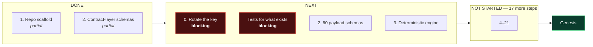

# Implementation plan

> **Status refresh — 2026-07-28:** The numerical test summary below captured an
> earlier intermediate checkout and is retained as historical planning context.
> The current workspace has an executable offline vertical slice:
> `npm run world -- demo` creates Genesis, runs deterministic limited-observation
> turns, appends hash-chained events, exports a read-only map projection, and
> independently replays to the identical checksum. The turn worker now has
> integration coverage for successful commit, duplicate delivery, and provider
> outage/retry. Run `npm test` for the live count. Firestore, production Gemini
> composition, Cloud Tasks, and public Genesis remain intentionally incomplete.

**Ordering follows §25's 21 steps exactly.** §25 is explicit that they are done in that order, and
that graphics do not precede the simulation, replay and audit foundations.

**Effort estimates are in engineer-days** for one experienced TypeScript engineer who has read the
spec, including tests and review. They are honest rather than optimistic: they assume the tests in
[testing-strategy.md](./testing-strategy.md) actually get written, because a step without them is
not done under §26.

---

## 0. Status summary — verified by running the suite

`npx vitest run` → **252 tests, 250 passing, 2 failing.** Under §26, a component with a failing test
is not complete, so the two failures below hold `buildObservation` out of the Implemented column.

### Implemented — code exists *and* its tests pass

| Component | Evidence |
|---|---|
| Determinism primitives — canonical JSON, SHA-256 + domain tags, SplitMix64 RNG, derived ids, sim-time | `canonical.test.ts` (30 ✓), `rng.test.ts` (24 ✓) |
| Canonical event chain + verifier | `event.test.ts` (32 ✓), `packages/audit/src/verify.test.ts` (20 ✓) |
| State checksum | `engine/checksum.test.ts` (22 ✓) |
| Deterministic 32×32 map generation | `engine/mapgen.test.ts` (16 ✓) |
| Persistence adapters — in-memory + file event stores, state store, idempotency store, clock | `memory-event-store.test.ts` (12 ✓), `file-event-store.test.ts` (20 ✓), `state-store.test.ts` (24 ✓), `memory-idempotency-store.test.ts` (11 ✓), `clock.test.ts` (10 ✓) |
| Action payload schemas — 16 grouped modules covering the 60-action vocabulary | `schema/actions/*.ts` — compile-checked; **no dedicated test file** |
| CI — gitleaks secret scan gating typecheck/test/build | `.github/workflows/ci.yml` |

### In progress — code exists, tests failing or absent

| Component | State |
|---|---|
| **Observation builder** (`engine/observation.ts`) | ⚠ **2 failing tests.** One is a §15 leakage test — undisclosed organisation membership reaching an observation. See [threat-model.md](./threat-model.md) T-8 |
| Engine resolvers | ~29 registered of 60 actions; only `move`, `gather`, `basic` implemented as dedicated modules. No resolver test file |
| Cognition (`packages/cognition`) | Substantial: Gemini/scripted/replay providers, prompt builder, `untrusted.ts`, memory, budget, parse. **No test file in the package at all** |
| Entity schemas (`schema/entities/`) | artifact, condition, memory, organisation, structure, skills present; inhabitant/world state not consolidated |
| Spectator (`apps/spectator`) | Library layer only — `world-source.ts`, `fixture-world-source.ts`, `event-hash.ts`, `format.ts`. No routes, no UI |
| Audit CLI (`packages/audit/src/cli.ts`) | Verifier tested; CLI entry point untested |

### Not started

Turn scheduler / runtime (`packages/runtime/src/` is **empty**) · replay + audit *service* (as
opposed to the chain verifier, which exists) · Genesis tooling (`apps/genesis/src/` is **empty**) ·
ElevenLabs media layer · Firestore adapter (no Firestore reference anywhere in the tree) ·
`firestore.rules` · security-rules test matrix.

### Immediate priorities

1. **Fix the two failing observation tests.** One is an information leak; it is the top-ranked
   threat in [threat-model.md](./threat-model.md).
2. **Test `packages/cognition`.** It is the largest untested surface in the repo, and it is the
   component that handles untrusted model output.
3. **Move the service-account key out of `.env`.** Rotated, but re-pasted in the same unsafe form —
   [threat-model.md](./threat-model.md) T-5 action 3.

---

## 1. Where the project actually is

### Verified present in the repository

| File | Status |
|---|---|
| `packages/core/src/util/canonical.ts` | **Implemented** — canonical JSON, float ban, `NonCanonicalValueError` |
| `packages/core/src/util/hash.ts` | **Implemented** — SHA-256, `HashDomain` tags, `GENESIS_PREV_HASH`, `hashEquals` |
| `packages/core/src/util/rng.ts` | **Implemented** — SplitMix64, derived streams, integer-only probability, rejection sampling |
| `packages/core/src/ids.ts` | **Implemented** — 12 branded id types, `deriveId` from event sequence |
| `packages/core/src/time.ts` | **Implemented** — `SimTime`/`Duration`, clock, `isNight` |
| `packages/core/src/event.ts` | **Implemented** — envelope, visibility union, provenance, `sealEvent`, `verifyChain` |
| `packages/core/src/ports.ts` | **Implemented** (interfaces) — `EventStore`, `StateStore`, `IdempotencyStore`, `ModelAuditStore`, `ModelProvider`, `SpendLimitExceededError` |
| `packages/core/src/schema/primitives.ts` | **Implemented** — 8 resources, conservation set, bundle algebra, terrain, coords |
| `packages/core/src/schema/action-spec.ts` | **Implemented** (contract) — 60 action types, 17 activity states, `ActionSpec`, `ProposedActionSchema`, `ResolutionOutcome` |
| `package.json`, `tsconfig.base.json`, `vitest.config.ts`, `.gitignore`, `.env.example` | **Implemented** |
| `packages/{cognition,runtime,audit,persistence}/src`, `apps/{genesis,spectator}` | **Empty directories** |

### Verified absent

- No `firestore.rules`, no `firestore.indexes.json`, no Firestore adapter anywhere in the tree.
- `packages/runtime/src/` and `apps/genesis/src/` are **empty directories** — no scheduler, no
  Genesis CLI.
- No media layer, no spectator routes or UI, no security-rules test matrix.
- No test file in `packages/cognition` despite it being one of the larger packages.
- `packages/core/src/index.ts` does not re-export `schema/action-spec.js`.

### Honest summary

Steps 1–2 are substantially done and step 3–4 are genuinely under way. The determinism layer, the
event chain, the verifier and the persistence adapters are real, tested and good — the comments
explain *why*, not just *what*, and the 250 passing tests are meaningful rather than decorative.

Two caveats keep this from being further along than it looks:

1. **The suite is red.** Two failing observation tests, one of them an information-leak test. Under
   §26 nothing built on `buildObservation` can be described as working until they pass.
2. **`packages/cognition` is entirely untested** — and it is the component that ingests untrusted
   model output, which is the boundary [threat-model.md](./threat-model.md) T-1 depends on.

Call it **step 4 of 21, with the foundations sound and the assurance work lagging the
implementation.** The remaining work is still the majority of the project, but the hardest
correctness decisions — encoding, hashing, RNG derivation, chain verification — are made and proven.

---

## Step 0 — Prerequisites (not in §25)

Not part of §25's ordering, but blocking everything.

| Task | Effort | Status |
|---|---:|---|
| Rotate the exposed Firebase service-account key | 0.5 d | ✅ **Done** |
| First commit; repo live at `github.com/sidevworks/after-genesis` (private) | 0.5 d | ✅ **Done** |
| CI: gitleaks secret scan gating typecheck / test / build | 1.5 d | ✅ **Done** |
| Tests for the contract layer (L1–L3): canonical JSON, RNG, event chain, checksum, mapgen | 5 d | ✅ **Done** — 250 passing |
| **Fix the 2 failing observation tests** (one is a §15 leak) | **1 d** | ❌ **Blocking — top priority** |
| **Move credentials to Secret Manager; stop pasting keys into `.env`** ([threat-model.md](./threat-model.md) T-5 action 3) | 1 d | ❌ Genesis-blocking |
| Confirm four separate Firebase projects; least-privilege runtime identity (not Admin) | 2 d | ❌ Genesis-blocking |
| Tests for `packages/cognition` — the untrusted-input boundary, currently 0 tests | **4 d** | ❌ Blocking |
| Golden-vector suite pinning canonical JSON / RNG / event hashes across the Node matrix | 2 d | ❌ Outstanding |
| `npm ci --ignore-scripts` in CI; pre-commit secret scan | 0.5 d | ❌ Outstanding |
| Export `schema/action-spec.js` from `packages/core/src/index.ts` | 0.1 d | ❌ Outstanding |
| Verify current provider pricing; recompute [cost-control.md](./cost-control.md) | 1 d | ❌ **Genesis-blocking** |
| **Remaining** | **~11.6 d** | |

The two failing observation tests are the highest-value work available right now: one of them is an
information leak, which is the top-ranked threat in the model, and everything that consumes an
observation inherits the defect until it is fixed.

The second-highest is testing `packages/cognition`. It is substantial, complete-looking, and has
zero tests — and it is precisely the code that parses untrusted model output. §26 is explicit that a
feature is not done until it is tested; right now the most security-sensitive package in the
repository is the least verified.

---

## Steps 1–21 (§25)

### Phase A — Foundations (steps 1–6)

Everything here is deterministic, offline, and testable without a cloud account.

#### 1. Repository foundation and environment separation

**Status: Partially done.**

Done: workspace layout, strict TypeScript (`noUncheckedIndexedAccess`, `exactOptionalPropertyTypes`,
`verbatimModuleSyntax`), Vitest config, `.gitignore` with secret patterns, `.env.example`.

Remaining: four separate Firebase projects (§17); per-environment config loading with a schema;
CI; branch protection; the constitutional-file guard ([world-rules-v1.md](./world-rules-v1.md) §9.3).

| | |
|---|---|
| Effort | **4 d** |
| Genesis prerequisite | **Yes** — §28 requires no human-facing write route, which depends on environment separation |

#### 2. Versioned domain schemas

**Status: Mostly done.** `action-spec.ts` is complete. Payload schemas are implemented as **16
grouped modules** under `schema/actions/` (movement, resources, communication, construction,
knowledge, health, trade, contracts, organisations, currency, lineage, care, information, security,
law, common) rather than 60 individual files — a reasonable consolidation. Entity schemas exist for
artifact, condition, memory, organisation, structure and skills.

Remaining: consolidated inhabitant and world-state schemas ([schemas.md](./schemas.md) §7); a test
asserting the `ActionCatalogue` is total over all 60 action types; per-action schema tests (there is
currently **no test file** for any action schema).

| | |
|---|---|
| Effort | **4 d remaining** |
| Genesis prerequisite | **Yes** — §28 "every action is schema validated" |

#### 3. Deterministic world engine

**Status: In progress.** The largest single step in the project.

Done: `engine/state.ts`, `engine/checksum.ts` (22 ✓), `engine/mapgen.ts` (16 ✓),
`engine/invariants.ts`, the resolver framework (`resolvers/{types,payload,effects,index}.ts`) and
three resolver modules — `move`, `gather`, `basic`. ~29 of 60 action types are registered.

⚠ `engine/observation.ts` exists but **2 of its tests fail**, one being a §15 information-leak test.

Remaining: ~31 resolvers; precondition coverage across the full catalogue; activity-exclusivity
enforcement (§11A); conservation enforcement wired into every resolver; fixing and completing the
observation builder; all rules from [world-rules-v1.md](./world-rules-v1.md).

| | |
|---|---|
| Effort | **1 d** to fix observation + **22 d** remaining |
| Genesis prerequisite | **Yes** |

**Risks.** Resolver count is the driver, and resolvers vary enormously — `wait` is trivial;
`apply_treatment`, `attempt_transfer_without_consent` and `impose_confinement` each carry real rule
complexity. The observation builder is the highest-risk single component in the codebase: a bug
there is an information leak that nothing crashes on
([threat-model.md](./threat-model.md) T-8).

#### 4. Append-only event system

**Status: Done for the local adapters.** `verifyChain`, `sealEvent`, the in-memory event store (12
✓), the file/JSONL event store (20 ✓), the state store (24 ✓), the idempotency store (11 ✓) and the
file model-audit store are all implemented and passing.

Remaining: the adapter-equivalence contract test (one suite run against every adapter); the
Firestore adapter (counted under step 19).

| | |
|---|---|
| Effort | **2 d remaining** |
| Genesis prerequisite | **Yes** — §28 "every state transition is event sourced" |

#### 5. Grid map and resources

**Status: Not started.** Primitives are **Implemented**; generation is not.

Contents: deterministic 32×32 map generation from the published Genesis seed; tile yield and
regeneration; gather resolution; carry and storage limits; conservation invariant tests.

| | |
|---|---|
| Effort | **6 d** |
| Genesis prerequisite | **Yes** — §22.7 generates the map from the published seed |

#### 6. Turn scheduler and idempotency

**Status: Not started.** `IdempotencyStore` is **Implemented** as an interface.

Contents: eligibility selection; idempotency key derivation; the turn worker implementing §14's 18
steps; retry and backoff; the append-race handling from
[state-machines.md](./state-machines.md) §1; Cloud Tasks integration.

| | |
|---|---|
| Effort | **10 d** |
| Genesis prerequisite | **Yes** — §28 "duplicate tasks cannot duplicate outcomes" |

**Phase A total: ~73 d** (plus step 0's ~10 d).

---

### Phase B — Cognition and memory (steps 7–8)

#### 7. Gemini cognition interface

**Status: In progress — implemented but entirely untested.**

Present in `packages/cognition/src/`: `providers/gemini.ts`, `providers/scripted.ts`,
`providers/replay.ts`, `providers/errors.ts`, `prompt.ts`, `untrusted.ts` (the untrusted-content
region, [threat-model.md](./threat-model.md) M1.4), `parse.ts`, `memory.ts`, `budget.ts`,
`cognition.ts`, `types.ts`.

⚠ **There is no test file anywhere in this package.** It is the largest untested surface in the
repository and it is the boundary that handles untrusted model output — the one T-1's entire
mitigation rests on.

Remaining: tests for every module, especially `parse.ts` and `untrusted.ts`; the single-correction
flow (§14.10–11); token counting reconciled against real provider responses; the spend ceiling
ladder wired end to end ([cost-control.md](./cost-control.md) §6).

| | |
|---|---|
| Effort | **6 d remaining** (4 d of it tests) |
| Genesis prerequisite | **Yes** — §28 "spending limits work" |

**Note.** §3 names "Gemini 3.5 Flash-Lite" and "Gemini 3.6 Flash"; `.env.example` configures
`gemini-2.5-flash-lite` and `gemini-2.5-flash`. Model ids must be resolved against actual provider
availability before Genesis, and — because model selection is constitutional (§23) — the choice is
frozen for the world's lifetime. See §5 below.

#### 8. Memory system

**Status: Not started.**

Contents: episodic memory derivation from events (deterministic, replayable); the fixed-*k* integer
retrieval scorer; reflection generation as audited cognition; the `supersedes` chain; provenance
preservation through summarisation.

| | |
|---|---|
| Effort | **10 d** |
| Genesis prerequisite | **Yes** — §19's bounded retrieval is what makes cost finite ([cost-control.md](./cost-control.md) §5) |

**Phase B total: ~22 d.**

---

### Phase C — World systems (steps 9–15)

These are largely resolver work already counted in step 3, plus the state and query surface each
needs.

| # | Step | Effort | Genesis prerequisite | Notes |
|---|---|---:|---|---|
| 9 | Relationships and communication | 5 d | Yes | Directed private relationship records; conversation time cost for every participant (§11J) |
| 10 | Trade, contracts and ownership | 8 d | Yes | Contract lifecycle ([state-machines.md](./state-machines.md) §5). The engine records, it does not enforce |
| 11 | Skills and learning | 4 d | Yes | Practice, study, teaching. No careers (§9) |
| 12 | Inhabitant creation and lineage | 6 d | Yes | §7 preconditions, trait generation, imperfection roll, population ceiling |
| 13 | Health, treatment and death | 8 d | Yes | Condition progression, efficacy formula, iatrogenic harm, death preserving all history |
| 14 | Organisations and currencies | 8 d | Yes | Rules as data, never physics (§11G). Supply-rule enforcement |
| 15 | Creative artifacts | 5 d | Yes | Provenance, revision history, publication. **No image generation** — see §5 judgement call 4 |

**Phase C total: ~44 d.**

---

### Phase D — Surfaces (steps 16–17)

#### 16. Spectator interface

**Status: Not started.**

Contents: Next.js app; map, clock, population, event feed, profiles, lineage, relationships,
organisations, contracts, currencies, artifacts, timeline, search, economy dashboard, mortality
history, transparency page (commit, chain status, checksum). Playwright tests proving the app has no
write controls (§20).

| | |
|---|---|
| Effort | **20 d** |
| Genesis prerequisite | **Partially** — §28 requires no human-facing write route, so the *absence* of controls must be proven. The richness of the UI is not a Genesis gate; §25 explicitly deprioritises graphics |

#### 17. ElevenLabs media layer

**Status: Not started.**

Contents: event-selection policy; async generation; Cloud Storage; the read-only guarantee;
verbatim/condensed/dramatised labelling (§21).

| | |
|---|---|
| Effort | **8 d** |
| Genesis prerequisite | **No.** §28 does not mention media. A world can run silently. §15's "media services cannot mutate world state" must be tested if media exists at all |

**Phase D total: ~28 d.**

---

### Phase E — Assurance (steps 18–21)

This phase is where §28's requirements are actually met, and it is the phase most likely to be
compressed under pressure. It should not be.

#### 18. Audit verifier and replay

**Status: Partially done.** `packages/audit/src/verify.ts` is implemented with **20 passing tests**;
`cli.ts` exists but is untested. `packages/cognition/src/providers/replay.ts` exists (untested).

Remaining: the replay *service* — driving the engine over a recorded log and comparing checksums;
CLI tests; the JSONL export format; the anchor publication job; nightly production replay with
paging on divergence.

| | |
|---|---|
| Effort | **9 d remaining** |
| Genesis prerequisite | **Yes** — §28 requires deterministic replay and matching checksums |

#### 19. Security hardening

**Status: Not started.**

Contents: `firestore.rules` and `storage.rules` from [firestore-design.md](./firestore-design.md) §6;
the full emulator rules matrix; App Check; least-privilege IAM; egress restriction; rate limiting;
the emergency freeze with its public audit event.

| | |
|---|---|
| Effort | **12 d** |
| Genesis prerequisite | **Yes** — §28 "security rules pass automated tests" |

#### 20. Accelerated testing and dress rehearsal

**Status: Not started.** The four §24 phases.

| Sub-phase | Effort | Notes |
|---|---:|---|
| Phase 1 — mechanical simulation harness + 1M turns | 10 d | Cheap to run; expensive to build |
| Phase 2 — adversarial corpora + fuzzing | 12 d | The attack corpora from [threat-model.md](./threat-model.md) |
| Phase 3 — accelerated civilisation | 8 d build + **14 d elapsed** | ~$700 at reduced scope. §24's literal scope costs ~$47,000 — see [cost-control.md](./cost-control.md) §7 |
| Phase 4 — production dress rehearsal | 5 d build + **14 d elapsed, minimum** | Any unexplained divergence resets the 14 days to zero |
| Launch-readiness report (§24) | 3 d | |

| | |
|---|---|
| Effort | **38 d of work + ≥ 28 d elapsed** |
| Genesis prerequisite | **Yes** — §28 requires all four phases and 14 continuous rehearsal days |

#### 21. Genesis tooling

**Status: Not started.**

Contents: the §22 twelve-step Genesis command — verify tests, verify production rules, verify
database emptiness, verify the signed release commit, record the deployment digest, publish the
Genesis configuration, generate the map from the published seed, create exactly one founder, create
the first hash-chained event, remove nonessential canonical write credentials, start the scheduler,
publish public verification data. Atomic or safely reversible before the first canonical event.

| | |
|---|---|
| Effort | **8 d** |
| Genesis prerequisite | **Yes**, definitionally |

**Phase E total: ~70 d of work + ≥ 28 d elapsed.**

---

## 2. Totals and schedule

Remaining effort only — work already done and passing is excluded.

| Phase | Steps | Original | **Remaining** |
|---|---|---:|---:|
| 0 — Prerequisites | — | 10 | **12** |
| A — Foundations | 1–6 | 73 | **46** |
| B — Cognition and memory | 7–8 | 22 | **12** |
| C — World systems | 9–15 | 44 | **44** |
| D — Surfaces | 16–17 | 28 | **26** |
| E — Assurance | 18–21 | 70 | **67** |
| **Total** | | 247 | **207 eng-days** |
| Contingency at 30% | | | **+62** |
| **Planning total** | | | **≈ 270 eng-days** |

Roughly **40 engineer-days of the original 247 are genuinely banked** — the determinism layer, the
event chain, the verifier, map generation and the persistence adapters, all with passing tests. That
is real progress on the hardest-to-get-right part of the system.

Phase 0 *rose* from 10 to 12 despite three of its tasks being complete, because the failing
observation tests and the entirely untested cognition package are new work that did not exist as
line items before.

| Team | Elapsed (incl. ≥ 28 d of rehearsal that cannot be parallelised) |
|---|---|
| 1 engineer | ~13 months |
| 2 engineers | ~8 months |
| 3 engineers | ~6 months (coordination overhead begins to bite; §11D applies to us too) |

**30% contingency is low for a project of this novelty.** It assumes the world rules survive §24
phase 3 without needing retuning. They probably will not — [world-rules-v1.md](./world-rules-v1.md)
§11 flags several numbers as likely to need adjustment after real-model runs, and because those
numbers are constitutional, adjusting them means re-running phases 3 and 4 from scratch. A realistic
plan should budget for **at least one full loop back from phase 3 to the rules**, adding roughly 30
elapsed days.

---

## 3. The §27 vertical slice

§27 asks for "the first executable vertical slice" as deliverable 12. It is the right next
milestone after step 0, and it is much smaller than the full plan.

Required demonstrations, mapped to steps:

| §27 requirement | Steps needed | Effort |
|---|---|---:|
| One founder on a deterministic grid | 5 (map), 12 (founder creation only) | 4 d |
| Limited observation | 3 (observation builder only) | 3 d |
| One Gemini-selected structured action | 7 (Gemini adapter, one action) | 4 d |
| Deterministic validation and resolution | 2, 3 (one resolver: `move`) | 2 d |
| An append-only hash-chained event | 4 (in-memory adapter) | 2 d |
| An idempotent state update | 6 (idempotency only) | 2 d |
| A read-only spectator map | 16 (map view only) | 4 d |
| A replay that reconstructs the same state | 18 (replay adapter only) | 3 d |
| **Total** | | **24 d** |

Plus step 0's 10 days. **~34 days to a working, honest, end-to-end vertical slice** that exercises
every architectural boundary once. This is the highest-value milestone in the plan, because it
validates the architecture before 200 more days are spent on it.

§27 is emphatic: "Do not attempt the complete platform in one unverified change. Build it as tested
vertical slices while preserving the full architecture."

---

## 4. Genesis prerequisites (§28) — consolidated

| Requirement | Steps | Status |
|---|---|---|
| No human-facing canonical write route | 1, 16, 19 | Not started |
| Every action schema validated | 2 | **In progress** — schemas exist, catalogue-totality test missing |
| Every state transition event sourced | 3, 4 | **In progress** — chain + adapters done and tested; engine partial |
| Duplicate tasks cannot duplicate outcomes | 6 | **In progress** — idempotency store done (11 ✓); scheduler not started |
| Full deterministic replay from stored model outputs | 7, 18 | **In progress** — verifier done (20 ✓); replay service not started |
| Reconstructed and production checksums match | 18, 20 | Not started |
| Spending limits work | 7, 8 | **In progress** — `budget.ts` exists, untested, ladder not wired |
| Security rules pass automated tests | 19 | Not started |
| Backup and recovery rehearsed | 20 (phase 4 day 10) | Not started |
| 14 continuous rehearsal days, no unexplained divergence | 20 | Not started |
| Genesis build, prompt, rules, seed, digest publishable | 21 | Not started |
| A fault can pause but not silently rewrite | 6, 19, 20 | Not started |

**Not in §28 but Genesis-blocking** ([threat-model.md](./threat-model.md)):

| Requirement | Status |
|---|---|
| Rotate the exposed service-account key | ✅ **Done** |
| CI secret scan gating the build | ✅ **Done** — gitleaks over full history |
| **Stop storing key material in `.env`** (Secret Manager / `GOOGLE_APPLICATION_CREDENTIALS` path) | ❌ **Outstanding — the replacement key was pasted back in the same form** |
| Four separate Firebase projects | ❌ Not started |
| Least-privilege runtime identity (not Firebase Admin) | ❌ Not started |
| Provider pricing verified; ceilings recomputed | ❌ Not started |
| Chain anchoring live | ❌ Not started |
| **Green test suite** (2 failing, one a §15 leak test) | ❌ **Outstanding** |

**Not Genesis prerequisites:** step 17 (media), and the richness — though not the read-only
guarantee — of step 16 (spectator). §25 is explicit that graphics do not precede the foundations,
and §26 ranks visual polish last of ten.

---

## 5. Judgement calls

1. **Effort estimates are guesses.** No comparable system exists to calibrate against. The 60
   resolvers at 0.4 d each is the number I trust least: `wait` is minutes, `apply_treatment` is
   days. The distribution matters more than the mean, and it is unknown.

2. **Step 3 is treated as one 35-day step rather than split.** It is really "implement the entire
   physics of a world" and could reasonably be a project of its own. Keeping §25's numbering intact
   matters more than sub-dividing it here.

3. **Steps 9–15 overlap step 3 substantially.** §25 lists them separately, but most of their content
   *is* resolvers. Effort has been allocated to avoid double-counting; the split is somewhat
   arbitrary and the phase totals are more reliable than the per-step ones.

4. **§12's images and designs have no generation path.** §3 and §4G provide only ElevenLabs audio.
   Step 15 is scoped to artifacts-as-records with textual content and no rendered asset. Adding
   image generation later would be a constitutional change (§13, §23) requiring a new world, so if
   it is wanted, it must be decided **before** Genesis.

5. **§3's model names do not correspond to `.env.example`'s.** The spec says "Gemini 3.5 Flash-Lite"
   and "Gemini 3.6 Flash"; the config says `gemini-2.5-flash-lite` and `gemini-2.5-flash`. §3 allows
   "an equivalent replacement" where availability requires, but §23 makes the choice constitutional
   and therefore permanent for the world. **Providers deprecate models on timescales shorter than 16
   months.** A world whose model is deprecated mid-run faces a forced constitutional change — either
   the world ends, or it continues under a different model and the experiment's integrity claim
   weakens. This is a structural conflict in the spec, not an oversight in configuration, and it has
   no clean resolution. Mitigations worth considering before Genesis: pin to a model with a
   published long-term availability guarantee; prefer a self-hostable model; or state publicly, in
   advance, exactly what will happen when the model is deprecated.

6. **The plan assumes the world rules survive §24 phase 3 unchanged.** They probably will not. A
   realistic schedule budgets for at least one loop back from phase 3 to
   [world-rules-v1.md](./world-rules-v1.md), which means re-running phases 3 and 4 in full — roughly
   30 additional elapsed days, and a second $700 of rehearsal inference.
