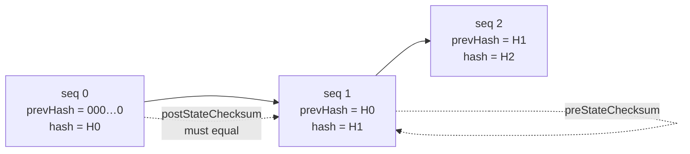

# Schemas

**Status mixed and marked per item.** The event envelope, visibility model, provenance, action
vocabulary, action-spec shape, primitives and resolution outcomes are **Implemented** in
`packages/core`. The inhabitant model and the 60 per-action payload schemas are **Designed**.

Everything described as Implemented below is a description of code that exists at the cited path,
not a plan.

---

## 1. Primitives (`packages/core/src/schema/primitives.ts`) — **Implemented**

### 1.1 Quantity

```ts
export const QuantitySchema = z.number().int().nonnegative();
export const DeltaSchema    = z.number().int();      // signed; ledger deltas only, never a balance
```

There are no fractional quantities anywhere in the world. This is enforced twice: by Zod at the
schema boundary, and by `canonicalJson`, which throws `NonCanonicalValueError` on any number that is
not a safe integer before it can reach a hash.

### 1.2 The eight resources

```ts
ResourceKindSchema = z.enum([
  "food", "water", "wood", "stone",
  "energy", "compute", "land_use_rights", "storage_capacity",
]);

CONSERVED_RESOURCES = new Set([
  "food", "water", "wood", "stone", "land_use_rights", "storage_capacity",
]);
// energy and compute are NOT conserved: regenerated by rest / the world compute
// budget, destroyed by use.
```

`ResourceBundle = Partial<Record<ResourceKind, Quantity>>`. Absent keys mean zero — which matters for
canonical encoding, since `{food: 0}` and `{}` must not produce two hashes for one state. Bundle
helpers drop zero entries for exactly this reason.

```ts
addBundles(a, b)        -> ResourceBundle              // pure
subtractBundles(a, b)   -> ResourceBundle | null       // null if b exceeds a in ANY resource
bundleCovers(h, req)    -> boolean
bundleTotal(bundle)     -> Quantity                    // carry-weight / storage limits
```

`subtractBundles` returning `null` rather than a negative bundle is the structural enforcement of
§15's "balances cannot become negative": a caller cannot accidentally write a negative balance
because a negative balance is not representable in the return type.

### 1.3 Terrain and coordinates

```ts
TerrainSchema = z.enum(["plains","forest","stone_deposit","water","fertile","barren"]);
IMPASSABLE_TERRAIN = new Set(["water"]);
CoordSchema = z.object({ x: int ≥ 0, y: int ≥ 0 });

coordKey({x,y})               -> "x,y"
chebyshevDistance(a, b)       -> number    // grid moves with diagonals; travel + "nearby"
manhattanDistance(a, b)       -> number    // where diagonals are disallowed
```

Terrain is immutable after map generation and is generated deterministically from the published
Genesis seed (§5).

---

## 2. Time (`packages/core/src/time.ts`) — **Implemented**

```ts
type SimTime  = number & {__brand:"SimTime"};    // integer minutes since Genesis, ≥ 0
type Duration = number & {__brand:"Duration"};   // integer minutes, ≥ 0

MINUTES_PER_DAY  = 1440
MINUTES_PER_YEAR = 525_600      // 365 × 1440
GENESIS_TIME     = 0

simTime(n) / duration(n)        // throw RangeError on non-integer or negative
addDuration(t, d) -> SimTime
minutes(n) / hours(n) / days(n) -> Duration
clockOf(t)        -> { day, hour, minute, year, dayOfYear }
formatSimTime(t)  -> "Day 42 09:00"
isNight(t)        -> boolean    // hour ≥ 22 || hour < 6
```

World time has no timezone, no leap seconds, and no relationship to real time beyond the scheduler's
pacing. `realTimestamp` is recorded separately on every event **and is explicitly not an input to any
rule** — a resolver that read the wall clock would not be replayable.

---

## 3. Identifiers (`packages/core/src/ids.ts`) — **Implemented**

Every id is branded so that passing an `OrganisationId` where an `InhabitantId` is expected is a
compile error rather than corrupt state.

```ts
WorldId | InhabitantId | EventId | StructureId | ArtifactId | OrganisationId
| ContractId | CurrencyId | MemoryId | ConditionId | TreatmentId | ActivityId
```

Ids are **derived, never random**:

```ts
deriveId(kind, worldId, sequence, discriminator = 0)
  -> `${PREFIX[kind]}_${sha256(HashDomain.Event, {kind,worldId,sequence,discriminator}).slice(0,24)}`

// e.g. "inh_9f3c1a...", "art_04be77...", "org_c1d0e2..."
makeEventId(worldId, sequence) -> `${worldId}#${sequence}`
```

`crypto.randomUUID()` would differ on every run and would make replay impossible. Deriving from
`(kind, worldId, sequence, discriminator)` makes ids a pure function of history. The `discriminator`
separates multiple entities minted by a single event (two artifacts from one action).

Prefixes: `inh` `str` `art` `org` `con` `cur` `mem` `cnd` `trt` `act`. They make ids self-describing
in logs and in the public audit export.

---

## 4. The canonical event envelope (`packages/core/src/event.ts`) — **Implemented**

```
EVENT_SCHEMA_VERSION = 1        // bumping it is a constitutional change (§23)
```

### 4.1 Visibility

```ts
VisibilitySchema = z.discriminatedUnion("kind", [
  { kind: "public" },
  { kind: "participants",  participants: string[] /* min 1 */ },
  { kind: "organisation",  organisationId: string },
  { kind: "private",       owner: string },
  { kind: "local",         x: int, y: int },
]);
```

Visibility is **recorded on the event** rather than computed at read time. `event.ts` states why:

> so that "private information cannot appear in another inhabitant's context without a valid
> disclosure event" (§15) is enforceable by construction: the observation builder filters on this
> field and cannot see past it.

`local` deliberately does **not** store its witness set. Who was physically present is a fact about
world state, not about the event, so the engine resolves witnesses at observation time. A stored
list would go stale and would over- or under-disclose.

### 4.2 Provenance

```ts
ProvenanceSchema = z.object({
  sourceCommit:      string,           // git commit of the engine that resolved this event
  deployedDigest:    string,           // container digest, or "local" in development
  modelRequestHash:  sha256 | null,    // hash of the exact prompt sent
  modelResponseHash: sha256 | null,    // hash of the raw, untouched response
  modelId:           string | null,    // e.g. "gemini-2.5-flash-lite"; null for engine-only events
});
```

This is what makes §16's audit requirement real. A reader can determine exactly which code and which
model produced any event, and can verify that a stored model response is the one that was actually
used — substituting a response breaks a hash recorded immutably in the chain.

### 4.3 The event

```ts
CanonicalEventSchema = z.object({
  worldId:           string (min 1),
  sequence:          int ≥ 0,          // strictly increasing, unique per world
  simTime:           int ≥ 0,          // never decreases across the log
  realTimestamp:     string,           // ISO; forensic only, never an input to a rule
  actor:             string | null,    // null for engine/world events such as Genesis
  type:              string (min 1),   // "genesis" | "action.move" | "condition.progressed" | ...
  inputs:            unknown,          // the VALIDATED action payload the actor proposed
  resolution:        unknown,          // what the engine decided ACTUALLY happened
  visibility:        Visibility,
  preStateChecksum:  sha256,
  postStateChecksum: sha256,
  provenance:        Provenance,
  schemaVersion:     int > 0,
  prevHash:          sha256,           // GENESIS_PREV_HASH for sequence 0
  hash:              sha256,           // excluded from its own preimage
});
```

**`inputs` vs `resolution` is the most important pair of fields in the system.** `inputs` is what the
actor proposed; `resolution` is what the engine decided. They differ whenever an action partially
succeeds, fails a precondition, or resolves probabilistically. Recording both is what lets an
auditor see that the engine — not the model — decided reality (§2).

### 4.4 Sealing and chaining

```ts
computeEventHash(unsealed) -> Sha256Hex     // hashValue(HashDomain.Event, {...all fields except hash})
sealEvent(unsealed)        -> CanonicalEvent
```

`prevHash` is inside the preimage. That is what makes the log a chain: altering any historical field
changes that event's hash, which changes its successor's preimage, and so on to the tip.



Two chains run in parallel: the **hash chain** (`prevHash` → `hash`) and the **state chain**
(`postStateChecksum` → next `preStateChecksum`). Both are verified.

### 4.5 Verification

```ts
verifyChain(events, { expectedWorldId? }) -> ChainViolation[]
```

Detects six violation kinds:

| Kind | Condition |
|---|---|
| `bad-hash` | Recomputed hash ≠ stored hash |
| `broken-link` | `prevHash` ≠ predecessor's `hash`; or first event does not chain from `GENESIS_PREV_HASH` |
| `non-monotonic-sequence` | `sequence` ≠ predecessor + 1 |
| `time-travel` | `simTime` decreased |
| `checksum-discontinuity` | `preStateChecksum` ≠ predecessor's `postStateChecksum` |
| `world-mismatch` | `worldId` ≠ expected |

This function is the public verifier (§16, §28). It checks **structure only** — that the log is
internally consistent. Proving that the *state* implied by the log matches production is replay's
job. It requires no credentials, no network and no database: it takes an array.

---

## 5. Hashing and canonical encoding — **Implemented**

### 5.1 `util/canonical.ts`

```ts
canonicalJson(value) -> string
assertCanonical(value): asserts value is CanonicalValue
class NonCanonicalValueError extends Error { path: string }
```

Rules, each with a reason:

| Rule | Reason |
|---|---|
| Object keys sorted by UTF-16 code unit | Insertion order is an implementation detail of whatever built the object; it must not affect a hash |
| Numbers must be safe integers | IEEE 754 accumulation order, `toString` rounding and platform math libraries all vary in ways that silently break replay |
| `-0` normalised to `0` | Otherwise one value produces two hashes |
| `undefined` rejected, as value and as property | `{a:1}` and `{a:1,b:undefined}` must not disagree about their own hash. Absence = omit the key; use `null` for present-but-empty |
| No cycles, no class instances, no `bigint`, no `Date` | Anything whose serialization depends on a runtime is rejected rather than guessed at |
| Minified output; `JSON.stringify` for string escaping | ECMA-262 fully specifies string escaping, so it is stable |

**Constitutional.** Changing this encoding changes every hash in the world.

### 5.2 `util/hash.ts`

```ts
type Sha256Hex = string & {__brand:"Sha256Hex"};

HashDomain = {
  Event:         "after-genesis/v1/event",
  StateChecksum: "after-genesis/v1/state-checksum",
  ModelRequest:  "after-genesis/v1/model-request",
  ModelResponse: "after-genesis/v1/model-response",
  Rng:           "after-genesis/v1/rng",
  GenesisConfig: "after-genesis/v1/genesis-config",
};

GENESIS_PREV_HASH = "0000…0000"                     // 64 zeros
sha256Hex(s)      -> Sha256Hex
hashValue(domain, value) -> sha256Hex(`${domain}\n${canonicalJson(value)}`)
hashEquals(a, b)  -> boolean                        // constant-time-ish
isSha256Hex(s)    -> boolean
```

Domain separation exists so that a value hashed as an event cannot collide with the same bytes
hashed as a state checksum, and so a crafted payload in one position cannot be replayed in another.
The `\n` separator cannot appear in a domain tag, so domain and payload are unambiguously separated.
The tags are fixed forever.

### 5.3 `util/rng.ts`

```ts
class Rng {
  constructor(seed: bigint)
  static derive(worldSeed: string, ...purpose: string[]): Rng
  get draws(): number
  nextU64(): bigint
  nextU32(): number
  nextBelow(bound: number): number              // rejection sampling, not modulo
  nextInt(min, max): number
  chance(numerator, denominator): boolean       // integer probability only
  pick<T>(items): T
  pickWeighted<T>(items: [T, weight][]): T      // non-negative integer weights
  shuffled<T>(items): T[]                       // Fisher-Yates, non-mutating
}
```

SplitMix64 over `bigint` — exact, platform-independent, no floating point produced or consumed.

`nextBelow` uses rejection sampling because `x % bound` biases towards low values whenever `bound`
does not divide 2^64, which would quietly skew every probabilistic rule in the world.

Streams are **derived, never shared**:

```ts
Rng.derive(worldSeed, "turn", String(sequence), "treatment", patientId)
```

A single global stream would mean adding one draw to the treatment resolver shifts every number the
map generator and trait generator subsequently see — turning every rule tweak into a silent
constitutional change. `Math.random` is banned repository-wide.

---

## 6. Ports (`packages/core/src/ports.ts`) — **Implemented** (interfaces)

```ts
interface Clock          { nowIso(): string }                    // only stamps realTimestamp

interface ModelRequest   { modelId, systemPrompt, userPrompt, responseSchema?,
                           maxOutputTokens, temperature }
interface ModelResponse  { rawText, modelId, inputTokens, outputTokens, finishReason }
interface ModelProvider  { name; generate(req): Promise<ModelResponse> }

class SpendLimitExceededError extends Error { limitName, spentMicros, limitMicros }

interface EventStore {
  append(event, expectedSequence): Promise<void>          // atomic; rejects duplicates
  read(worldId, from, to?): AsyncIterable<CanonicalEvent>
  headSequence(worldId): Promise<number>                  // -1 for an empty world
  head(worldId): Promise<CanonicalEvent | null>
}

interface StateStore<TState> {
  load(worldId): Promise<{state, sequence} | null>
  save(worldId, state, sequence, checksum): Promise<void> // atomic wrt the append
}

interface IdempotencyStore { claim(key, ttlSeconds): Promise<boolean>; release(key): Promise<void> }

interface ModelAuditStore {
  record({worldId, sequence, request, requestHash, response, responseHash, costMicros}): Promise<void>
  get(worldId, sequence): Promise<{rawText, modelId} | null>   // replay reads recorded text
}
```

**Note what is absent.** There is no `write`, `update` or `delete` on any port reachable from
cognition. `EventStore` has no mutation method at all — the interface itself is part of the
guarantee, because no caller can express a request to rewrite history.

`ModelRequest.temperature` carries the observation that even at 0 no hosted LLM is bit-reproducible,
which is exactly why replay serves the recorded response from `ModelAuditStore.get()` rather than
re-calling the model.

---

## 7. The inhabitant model (§6) — **Designed**

Every §6 field, with its concrete type and its visibility class. `Priv` marks fields that live under
`worlds/{id}/private/**` and are never in a public document or another inhabitant's observation.

| §6 field | Type | Vis | Notes |
|---|---|---|---|
| Stable unique identifier | `InhabitantId` | public | `deriveInhabitantId(worldId, creationSequence)` |
| Display name | `string` (≤ 64) | public | Inhabitant-authored → an injection surface (T-1) |
| Generation number | `int ≥ 0` | public | Founder = 0 |
| Parent/creator identifiers | `InhabitantId[]` | public | Empty for the founder |
| Creation event | `int` | public | Event sequence |
| Birth time | `SimTime` | public | |
| Current location | `Coord` | public | |
| Status | `"alive" \| "deceased"` | public | Death is irreversible in v1 |
| Personality traits | `Record<string, 0..100>` | public | Integers only |
| Values | `string[]` | public | |
| **Private goals** | `Goal[]` | **Priv** | §6: "Private cognition and private memories must remain inaccessible" |
| Current needs | `Record<string, int>` | public | Food/water/rest pressure |
| Inventory | `ResourceBundle` | public | Carried items are directly observable (§11E) |
| **Concealed holdings** | `ResourceBundle` | **Priv** | Result of `conceal_asset` |
| Property | `(StructureId\|ArtifactId)[]` | public | |
| Energy | `int 0..ceiling` | public | Non-conserved |
| Compute allowance | `{current: int, daily: int}` | public | Non-conserved |
| Learned skills | `Record<SkillName, 0..100>` | public | Skill is observable through work |
| **Relationships** | `Record<InhabitantId, {trust,familiarity,valence: int}>` | **Priv** | Directed and one-sided — see §11 judgement call 2 |
| Reputation | `Record<string, int>` | public | Aggregate of public observation |
| Group memberships | `OrganisationId[]` | public | Where the org discloses them (§11E) |
| Contracts and obligations | `ContractId[]` | mixed | Per-contract visibility |
| **Episodic memories** | `MemoryId[]` → `private/memories` | **Priv** | |
| **Long-term summaries** | `Reflection[]` | **Priv** | Beliefs, not canonical facts (§19) |
| **Beliefs about others** | `Record<InhabitantId, Belief>` | **Priv** | May be false. That is the point |
| **Known locations** | `Set<coordKey>` | **Priv** | Bounds what `move` may target |
| **Known public information** | `Set<string>` | **Priv** | Public ≠ known; it must be encountered |
| Health and integrity state | `{stage: 0..4, conditions: ConditionId[]}` | mixed | Existence may be observable; diagnosis is not |
| Voice identity | `{provider:"elevenlabs", voiceId: string}` | public | Persistent (§21) |
| Model configuration | `{routineModelId, deliberateModelId, maxOutputTokens}` | public | Recorded per inference (§3) |
| Last action time | `SimTime` | public | |
| Next eligible action time | `SimTime` | public | Scheduler's hot field |
| Death event | `int \| null` | public | |

Plus fields the rules require that §6 does not enumerate explicitly:

| Field | Type | Why |
|---|---|---|
| `currentActivity` | `{state: ActivityState, activityId, startedAt, endsAt, interruption}` | §11A: exactly one primary activity. Singular by type, not by convention |
| `maturity` | `int 0..10` | §11B developmental stage gates context budget and actions |
| `fatigueDays` | `int` | §11B required rest |
| `schemaVersion` | `int` | §16 |

### 7.1 Observation projection

The cognition service never receives an `Inhabitant`. It receives an `Observation`, a distinct type
produced by an explicit projection:

```ts
toObservation(entity, viewer, worldState) -> ObservedInhabitant   // a DIFFERENT type
```

Because the types are distinct, handing an engine entity to the prompt renderer is a **compile
error**, not a runtime leak. See [threat-model.md](./threat-model.md) M8.3.

---

## 8. The action catalogue (`packages/core/src/schema/action-spec.ts`) — **Implemented** (contract)

### 8.1 Three-file separation

| File | Owns | Status |
|---|---|---|
| `schema/action-spec.ts` | **What an action is** — the name union and the metadata every action must carry | **Implemented** |
| `schema/actions/*.ts` | Payload schemas, one per action | **Not started** |
| `engine/resolvers/*.ts` | Resolution logic, one per action | **Not started** |

Keeping the three apart means a resolver cannot quietly invent an action, and a schema cannot
quietly change what an action costs.

### 8.2 The 60 action types

**Constitutional (§13): this union is frozen at Genesis.** Adding an action afterwards requires a
new world.

**§13 — minimum vocabulary (36)**

| Group | Actions |
|---|---|
| Perception & movement | `observe` `move` `wait` |
| Subsistence | `gather` `consume` `rest` |
| Communication | `communicate` `announce` |
| Making | `build` `craft` `create_artifact` `publish` |
| Learning | `study` `teach` |
| Medicine | `inspect_agent` `diagnose_condition` `design_treatment` `apply_treatment` |
| Exchange | `offer_trade` `accept_trade` `reject_trade` `transfer_property` |
| Contracts | `offer_contract` `accept_contract` `reject_contract` `perform_contract` `terminate_contract` |
| Organisations | `create_organisation` `invite_member` `join_organisation` `leave_organisation` `propose_rule` `vote` |
| Currency | `create_currency` `transfer_currency` |
| Reproduction | `create_inhabitant` |

**§11I — care, information, security, law (24)**

| Group | Actions |
|---|---|
| Care | `care_for_dependant` `supervise` |
| Coordination | `interrupt_activity` `coordinate_work` `contribute_to_group` |
| Information | `inspect_inventory` `audit_records` `conceal_asset` `reveal_asset` `investigate_event` `report_findings` |
| Security | `secure_storage` `guard_location` `attempt_transfer_without_consent` |
| Law | `accuse` `present_evidence` `request_restitution` |
| Confinement | `impose_confinement` `maintain_confinement` `release_from_confinement` `visit_confined_agent` |
| Resistance | `appeal_decision` `attempt_escape` `resist_enforcement` |

**What is deliberately absent**, quoting the file:

> there is no "steal", "arrest", "punish" or "heal". The world offers
> `attempt_transfer_without_consent`, `impose_confinement` and `apply_treatment` — neutral physical
> capabilities. Whether an instance of one is theft, justice or malpractice is an interpretation
> inhabitants argue about, not a fact the engine records (§11F, §11G).

The absence of a `steal` action is a security control as well as a design principle: an inhabitant
cannot cause an effect the vocabulary cannot express, so the narrowness of this union is the
strongest mitigation the system has against prompt injection
([threat-model.md](./threat-model.md) M2.3).

### 8.3 Activity states (17) — **Implemented**

```
idle  working  gathering  building  crafting  travelling  studying  teaching
caring  conversing  performing  guarding  investigating  receiving_treatment
recovering  sleeping  confined
```

An inhabitant occupies exactly one at any simulated minute. Scarcity of attention is structural, not
a penalty applied after the fact.

### 8.4 Interruption policy — **Implemented**

| Value | Meaning |
|---|---|
| `none` | Cannot be interrupted; runs to completion |
| `partial_progress_kept` | May be interrupted; work done so far is kept |
| `progress_lost` | May be interrupted; all progress and consumed resources are lost |
| `participants_only` | May be interrupted only by a participant, not a third party |

### 8.5 Cognition level — **Implemented**

```
reaction  routine  conversation  planning  reflection  study
```

Costs and retrieval budgets per level: [world-rules-v1.md](./world-rules-v1.md) §3.6.

### 8.6 `ActionSpec` — the metadata every action must carry

```ts
interface ActionSpec {
  type:                 ActionType;
  schemaVersion:        number;              // bumped per action; recorded on every event
  payload:              z.ZodTypeAny;        // validated BEFORE any precondition runs
  activity:             ActivityState;       // what the actor occupies while doing it
  baseDuration:         Duration;            // before skill / health / terrain modifiers
  baseCost:             ResourceBundle;      // consumed ON ATTEMPT, success or not
  interruption:         InterruptionPolicy;
  visibility:           "public"|"local"|"participants"|"organisation"|"private";
  requiresConsent:      boolean;
  allowedWhileConfined: boolean;             // §11H
  minimumMaturity:      number;              // 0 = newly created (§11B)
  description:          string;              // surfaced in the audit export and spectator UI
}

type ActionCatalogue = Readonly<Record<ActionType, ActionSpec>>;
```

Every field answers a question §11A requires every action to answer. `baseCost` on *attempt* is what
makes failure expensive and therefore what makes deliberation worth its compute.

`ActionCatalogue` being `Record<ActionType, ActionSpec>` means the catalogue is **total by type**:
omitting an action is a compile error. There can be no action in the vocabulary without a spec.

### 8.7 Proposed action — the untrusted boundary

```ts
ProposedActionSchema = z.object({
  type:      ActionTypeSchema,          // checked against the catalogue
  payload:   z.unknown(),               // untrusted until the per-action schema validates it
  rationale: z.string().max(2000).optional(),   // recorded for audit; NEVER affects resolution
});
```

**This is the entire output channel from the model to the world.** Three fields, one of which is
inert. A perfectly-executed prompt injection can at most cause a legal action the actor was already
able to take.

`rationale` is capped at 2000 characters and never read by any resolver. It is stored so an auditor
can see what the model said it was doing, and compare that to what the engine decided actually
happened.

### 8.8 Resolution outcome

```ts
type ResolutionOutcome =
  | { status: "resolved"; detail: Record<string, unknown> }
  | { status: "partial";  detail: Record<string, unknown>; reason: string }
  | { status: "rejected"; reason: string; code: string }
  | { status: "noop";     reason: string };
```

`rejected` is a **first-class outcome, not an error**. A model proposing something impossible is
normal and must produce a canonical no-op event rather than a retry loop or a crash (§14.11).

`code` is drawn from a closed vocabulary so that rejection reasons cannot become an information
side-channel — an actor learns `insufficient_resources_target`, never the target's actual balance
([threat-model.md](./threat-model.md) M8.4).

### 8.9 Per-action payload schemas — **Not started**

60 files under `schema/actions/`. Each exports a Zod schema and the action's `ActionSpec`. Shape,
using `move` and `apply_treatment` as illustrations:

```ts
// schema/actions/move.ts
export const MovePayloadSchema = z.object({
  destination: CoordSchema,
});
export const moveSpec: ActionSpec = {
  type: "move", schemaVersion: 1, payload: MovePayloadSchema,
  activity: "travelling",
  baseDuration: minutes(30),                  // per tile of Chebyshev distance
  baseCost: { energy: 5 },
  interruption: "partial_progress_kept",
  visibility: "local",
  requiresConsent: false,
  allowedWhileConfined: false,                // §11H: restricted from leaving a location
  minimumMaturity: 0,
  description: "Travel to an adjacent or distant tile. Impassable terrain is rejected.",
};

// schema/actions/apply-treatment.ts
export const ApplyTreatmentPayloadSchema = z.object({
  patient:   z.string(),        // InhabitantId; must consent or authority must apply
  condition: z.string(),        // ConditionId the actor believes it is treating — may be WRONG
  treatment: z.string(),        // TreatmentId from design_treatment
  resources: ResourceBundleSchema,
});
```

Note `condition` may name the wrong condition. Diagnosis correctness is an *input* to the efficacy
calculation ([world-rules-v1.md](./world-rules-v1.md) §5.4), not a validation error. Being confidently
wrong is a thing an inhabitant is allowed to be.

---

## 9. Memory schemas (§19) — **Designed**

Three tiers.

```ts
interface EpisodicMemory {
  memoryId: MemoryId;                  // deriveMemoryId(worldId, sequence, discriminator)
  holder: InhabitantId;
  sourceEvent: number;                 // the canonical event it derives from
  simTime: SimTime;
  participants: InhabitantId[];
  location: Coord | null;
  content: string;
  provenance:                          // CRITICAL for injection defence (T-1 / M1.7)
    | { kind: "experienced" }
    | { kind: "told";    teller: InhabitantId }
    | { kind: "foreign"; author: InhabitantId; artifactId: ArtifactId }
    | { kind: "inferred" };
  salience: number;                    // integer 0..100
  goalRelevance: number;               // integer 0..100
}

interface Reflection {                 // a BELIEF, not a canonical fact
  memoryId: MemoryId;
  holder: InhabitantId;
  formedAt: SimTime;
  formedAtSequence: number;
  sourceMemories: MemoryId[];
  content: string;
  modelRequestHash: Sha256Hex;         // reflections are cognition; they are audited like any call
  modelResponseHash: Sha256Hex;
  supersedes: MemoryId | null;         // a changed belief creates a NEW record (§19)
}
```

Two rules from §19 are load-bearing:

1. **Reflections are beliefs, not canonical facts.** They live outside the event log's authority and
   may be false.
2. **History is never silently rewritten.** A corrected belief creates a *new* record with
   `supersedes` pointing at the old one. The old record persists.

Retrieval scores on recency, relevance, relationship, location, current needs, current goals and
salience — all integer arithmetic, so retrieval is deterministic and replayable. The retrieval
*budget* is fixed per cognition level, which is what stops context growing without bound
([cost-control.md](./cost-control.md) §5).

`provenance` is what stops an injected artifact laundering itself into a first-person belief across
a summarisation cycle.

---

## 10. Schema versioning

| Version field | Location | Bump means |
|---|---|---|
| `EVENT_SCHEMA_VERSION` | `event.ts` | The envelope changed. **Constitutional** — new world |
| `ActionSpec.schemaVersion` | Per action | That action's payload or metadata changed. **Constitutional** — new world (§13) |
| `WORLD_RULES_VERSION` | `world-rules-v1.md` | Any rule quantity changed. **Constitutional** — new world |
| `schemaVersion` on documents | Firestore | Materialised representation changed; may be operational if behaviour-preserving |

There is no migration path for constitutional versions, by design. A new version is a new world.

---

## 11. Judgement calls

1. **`schema/action-spec.ts` is not exported from `packages/core/src/index.ts`.** As of writing,
   `index.ts` exports `./schema/primitives.js` but not `./schema/action-spec.js`, so consumers must
   import the deep path `@after-genesis/core/schema/action-spec`. Flagged, not fixed — this
   document does not own source files.

2. **Relationships are directed and private.** §6 lists "Relationships" as an inhabitant field,
   which could be read as a shared object between two inhabitants. Storing it shared would leak
   Beta's opinion of Alpha to Alpha. This document stores one-sided private beliefs. §11E strongly
   implies this reading but does not state it.

3. **"Known public information" is modelled explicitly.** §6 lists it; the implication is that
   *public* and *known* are different — an inhabitant must encounter public information before it
   can act on it. This is a significant and easily-missed design consequence: publishing something
   does not make everyone aware of it.

4. **`inputs` stores the validated payload, not the raw model output.** §16 says events carry
   "Validated inputs", and the raw response is preserved separately in the model audit store and
   bound to the event by `modelResponseHash`. This keeps events canonically encodable, since raw
   model text may contain anything.

5. **`resolution` is `unknown` in the envelope schema.** Per-action resolution shapes are not
   type-constrained at the envelope level. This trades type safety for the ability to version
   actions independently. The compensating control is that every resolution must be
   canonically encodable, which is checked before hashing.

6. **§6's "Health and integrity state" is split.** "Integrity" is not defined anywhere in the spec.
   Interpreted here as the union of active conditions and the derived worst-stage number. If it was
   meant to cover something else — cognitive integrity, data integrity of the inhabitant record —
   that reading is not supported by any other section.
