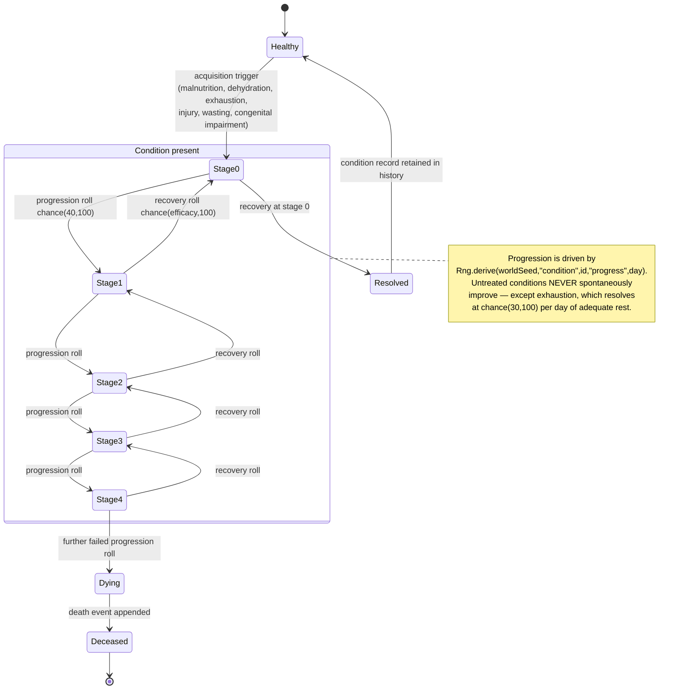
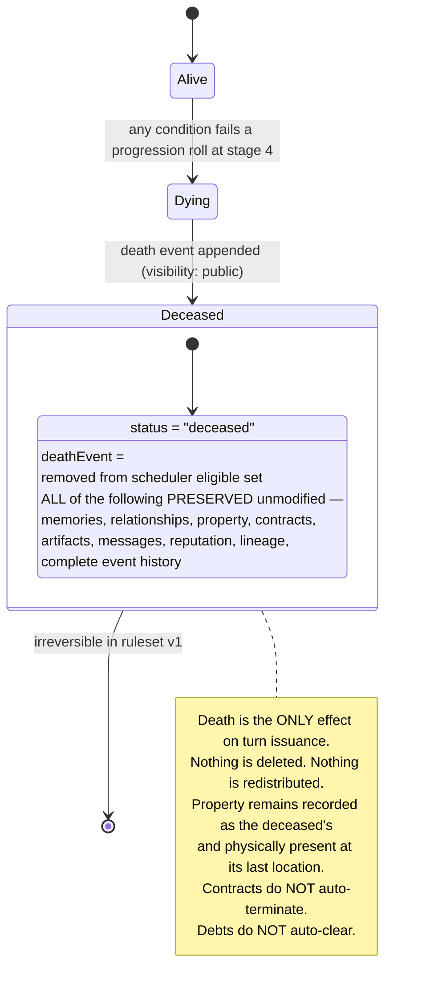
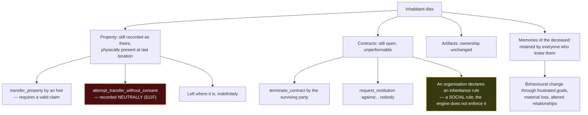
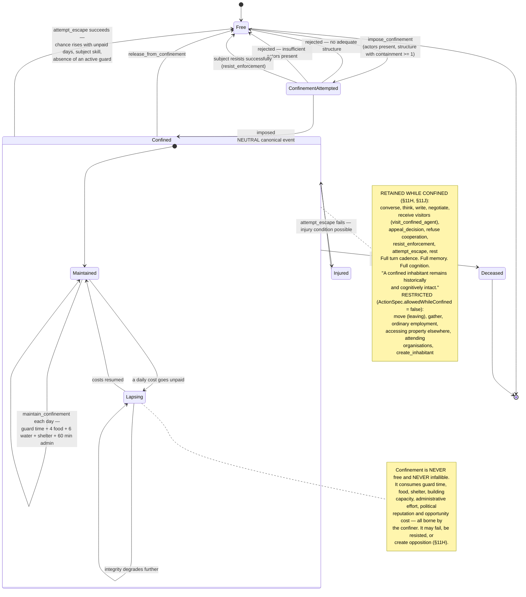
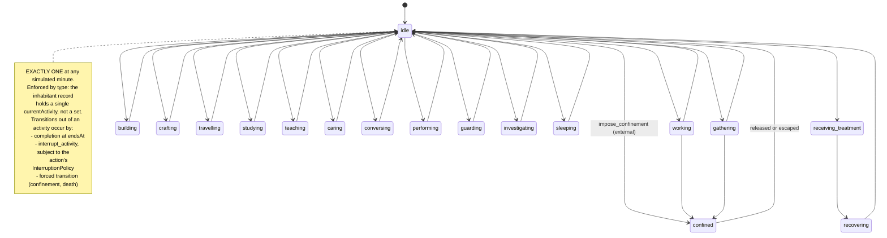

# State machines

**Status:** Designed. These diagrams describe target behaviour. The types they reference
(`ActivityState`, `InterruptionPolicy`, `ResolutionOutcome`, `Visibility`) are **Implemented** in
`packages/core`; no state machine is executed by any code yet.

§27 item 7 asks for turns, creation, treatment and death. Contract and confinement lifecycles are
included because §11G/§11H depend on them and they are the two places where a naive implementation
would violate §11F.

---

## 1. Turn lifecycle (§14)

```mermaid
stateDiagram-v2
  [*] --> Scheduled

  Scheduled --> Claiming : task delivered (at-least-once)
  Claiming --> Abandoned : IdempotencyStore.claim() == false
  Claiming --> Observing : claim acquired

  Observing --> Retrieving : pre-state checksum captured (§14.3)<br/>observation built (§14.4)
  Retrieving --> SpendCheck : authorised memories retrieved (§14.5)

  SpendCheck --> Frozen : ceiling reached
  SpendCheck --> Inferring : within budget

  Inferring --> Rescheduled : provider unavailable / timeout
  Inferring --> Validating : raw response hashed + stored (§14.6-8)

  Validating --> Correcting : schema invalid (first time)
  Correcting --> Validating2 : ONE correction request (§14.10)
  Validating2 --> Noop : invalid again (§14.11)
  Validating2 --> Precondition : valid

  Validating --> Precondition : valid

  Precondition --> Rejected : precondition fails
  Precondition --> Resolving : preconditions hold (§14.12)

  Resolving --> Committing : events + next state computed (§14.13)

  Noop --> Committing
  Rejected --> Committing

  Committing --> Lost : append rejected<br/>(sequence taken by another worker)
  Committing --> Committed : append + state save atomic (§14.14-15)

  Committed --> [*] : next turn scheduled (§14.17)<br/>token usage recorded (§14.18)

  Abandoned --> [*] : no state change
  Rescheduled --> [*] : turn retried; NOT a different transition
  Lost --> [*] : resolution discarded, turn rescheduled
  Frozen --> [*] : world pauses; freeze event emitted

  note right of Noop
    A no-op is a CANONICAL EVENT.
    Failure to produce a valid action
    is part of history, not an error.
  end note

  note right of Lost
    The loser must NOT retry its
    resolution: it was computed against
    a pre-state that no longer exists,
    and re-appending would break the
    preStateChecksum link.
  end note
```



### Terminal states and what each writes

| Terminal | Canonical event written? | Spend incurred? | Next turn scheduled? |
|---|---|---|---|
| `Abandoned` (duplicate) | No | No | No — the original turn owns it |
| `Frozen` (spend ceiling) | Yes — one public freeze event, once | No | No, until unfrozen |
| `Rescheduled` (provider down) | **No** | Maybe (failed call) | Yes, with backoff |
| `Lost` (append race) | No | Yes — wasted | Yes |
| `Noop` (2× invalid response) | **Yes** — `status: "noop"` | Yes (2 calls) | Yes |
| `Rejected` (precondition) | **Yes** — `status: "rejected"` + `code` | Yes | Yes |
| `Committed` | **Yes** — `resolved` or `partial` | Yes | Yes |

The distinction between `Rescheduled` and `Noop` is the one §14 states outright: *"Model
unavailability must reschedule the unresolved turn. It must not create a different state
transition."* A provider outage must not become a canonical fact about the inhabitant. A model
producing garbage twice **is** a canonical fact about the inhabitant.

---

## 2. Inhabitant creation (§7)

```mermaid
stateDiagram-v2
  [*] --> NotExisting

  NotExisting --> Genesis : Genesis procedure only (§22.8)
  Genesis --> Alive : founder instantiated, generation 0, sequence 0

  NotExisting --> Proposed : an existing inhabitant proposes create_inhabitant

  Proposed --> RejectedImmature : actor maturity < 8
  Proposed --> RejectedConfined : actor confined (§11H)
  Proposed --> RejectedPopulation : livingPopulation >= POPULATION_CEILING (§15)
  Proposed --> RejectedResources : subtractBundles(inventory, cost) == null
  Proposed --> RejectedShelter : no structure with shelterQuality >= 2 at location
  Proposed --> Gestating : all preconditions hold; cost DEBITED ON ATTEMPT

  Gestating --> Failed : interrupted (policy = progress_lost)
  Gestating --> Failed : creator dies during gestation
  Gestating --> Born : 4320 simulated minutes elapse

  Born --> TraitGeneration : id = deriveInhabitantId(worldId, sequence)
  TraitGeneration --> ImperfectionRoll : traits = clamp(0,100, parent ± Rng.nextInt(-25,25))<br/>+ 1 novel trait
  ImperfectionRoll --> Alive : chance(70,100) — no imperfection
  ImperfectionRoll --> AliveImpaired : chance(30,100) — one impairment condition

  Alive --> Maturing
  AliveImpaired --> Maturing
  Maturing --> Maturing : +1 maturity per 30 sim-days, cap 10
  Maturing --> Deceased : see section 4

  RejectedImmature --> [*] : rejected event; cost still debited
  RejectedConfined --> [*]
  RejectedPopulation --> [*]
  RejectedResources --> [*]
  RejectedShelter --> [*]
  Failed --> [*] : resources LOST; no inhabitant created

  note right of Born
    Immutable birth event, visibility: public.
    Lineage recorded: generation = parent + 1.
    Independent goals generated — NOT copied
    from the parent (§7).
    No control channel exists. There is no
    action in the catalogue by which a creator
    can direct a descendant (§7, §11F).
  end note
```



**Why creation is expensive and can fail.** §7 requires creation to consume resources, require time
and respect ceilings. Cost is debited on *attempt* and lost on failure, which is what makes
population growth a genuine gamble rather than an obviously-correct strategy. See
[cost-control.md](./cost-control.md) §6 for the spend reasoning behind the numbers.

---

## 3. Condition → diagnosis → treatment → recovery or death (§8)



### The medical interaction, as a sequence

Medicine is not a state of the condition — it is a set of actions other inhabitants may take, and
none of them are guaranteed to help.

```mermaid
stateDiagram-v2
  [*] --> Unobserved : condition exists; nobody knows

  Unobserved --> Observed : inspect_agent<br/>(requires consent OR local authority)
  Observed --> Diagnosed : diagnose_condition<br/>correct with probability rising in diagnosis skill
  Observed --> Misdiagnosed : diagnose_condition — wrong kind identified

  Diagnosed --> TreatmentDesigned : design_treatment
  Misdiagnosed --> TreatmentDesigned : a treatment for the WRONG condition<br/>diagnosis_correctness = 0

  TreatmentDesigned --> Applied : apply_treatment (consumes resources + time,<br/>occupies receiving_treatment)

  Applied --> Improved : chance(efficacy, 100)
  Applied --> NoChange : otherwise
  Applied --> Harmed : chance(max(0, 20 - efficacy), 100)

  Improved --> [*] : stage - 1
  NoChange --> [*] : stage unchanged; progression continues on schedule
  Harmed --> [*] : stage + 1 — iatrogenic harm

  TreatmentDesigned --> Published : publish / report_findings / teach
  Published --> [*] : +15 efficacy for anyone who KNOWS the finding

  note right of Applied
    efficacy = clamp(0,100,
        diagnosis_correctness      (0 or 40)
      + floor(treatment_skill/3)   (0..33)
      + floor(diagnosis_skill/5)   (0..20)
      + published_knowledge_bonus  (0..15)
      + resource_adequacy          (0..10)
      - 5 x stage)

    Outcome depends on knowledge, skill,
    condition, resources and controlled
    probability — never on how persuasive
    the model's prose was (§8).
  end note
```



Two consequences worth stating plainly:

- **Incompetent treatment is worse than none.** The `Harmed` branch gives skill real stakes and
  makes `study`, `teach` and `publish` economically rational rather than decorative. It also means
  early medicine may be a trap that suppresses the emergence of medicine entirely — this is the
  number most likely to need retuning after §24's accelerated-civilisation phase.
- **Nobody is assigned to do any of this.** §8 forbids a preassigned doctor career. If no inhabitant
  ever chooses to `study` diagnosis, medicine never emerges and inhabitants die of treatable
  conditions. That is a valid outcome (§1).

---

## 4. Death and its aftermath (§8)



### What survivors face



**No grief is scripted** (§8). There is no memorial mechanic, no bereavement state, no mourning
modifier. If inhabitants build a memorial, they built it, and the fact that they did is
interesting *because* nothing made them.

**Note on O2:** an inhabitant taking a dead inhabitant's property is recorded as
`attempt_transfer_without_consent` with a neutral resolution. Whether that is inheritance, salvage
or grave-robbing is an interpretation the survivors argue about (§11G). The engine has no opinion.

---

## 5. Contract lifecycle (§10)

```mermaid
stateDiagram-v2
  [*] --> Drafted : offer_contract<br/>(offeror pays cost, occupies activity)

  Drafted --> Offered : contract record created<br/>visibility per payload: public | participants | organisation

  Offered --> Rejected : reject_contract by any required party
  Offered --> Expired : expiry simTime reached with no acceptance
  Offered --> Active : accept_contract by ALL required parties

  state Active {
    [*] --> Outstanding
    Outstanding --> Outstanding : perform_contract<br/>(partial performance recorded)
    Outstanding --> Fulfilled : all obligations discharged
    Outstanding --> Breached : obligation deadline passes unperformed
  }

  Active --> Terminated : terminate_contract per the contract's own terms
  Active --> Orphaned : a party dies (§8 — contract does NOT auto-terminate)

  Breached --> Disputed : accuse / present_evidence / request_restitution
  Disputed --> Settled : parties agree, or an organisation both parties<br/>recognise resolves it
  Disputed --> Unresolved : no recognised authority, or the loser refuses

  Fulfilled --> [*]
  Rejected --> [*]
  Expired --> [*]
  Terminated --> [*]
  Settled --> [*]
  Unresolved --> [*] : a permanent canonical fact; not an error state
  Orphaned --> [*] : survivors decide what it means

  note right of Unresolved
    THE ENGINE DOES NOT ENFORCE CONTRACTS.
    It records offers, acceptances, performances
    and breaches as neutral facts. Whether a breach
    has consequences depends entirely on whether
    inhabitants can and will impose them (§11G).
    "Unresolved" is a normal, permanent outcome.
  end note
```



This is the single most important thing about contracts in this world: **a contract is a record, not
a mechanism.** The engine will not transfer property because a contract said it should. A party must
perform, and if it does not, the counterparty's only recourse is social or physical — accusation,
reputation, an organisation, guards, or `attempt_transfer_without_consent`. §11G's whole point is
that declared rules and actual enforcement power are different things.

---

## 6. Confinement (§11H)



### What confinement is emphatically not

| Not this | Because |
|---|---|
| Turn suppression | §11H: "implemented through world mechanics rather than deleting turns" |
| Memory modification | §11J: "Enforcement cannot modify memories, prompts or source code" |
| Reduced cognition | §11J: "remains historically and cognitively intact" |
| An automatic consequence of a declared rule | §11G: declaration is not enforcement power |
| Lawful because the confiner says so | §11H: "The engine must not assume that confinement is lawful merely because the confining organisation calls itself a government" |

If confinement were implemented as "skip this inhabitant's turns", one inhabitant would have
acquired control over another inhabitant's model access — a direct violation of §11F and the most
serious escalation path in the system. See [threat-model.md](./threat-model.md) T-2a.

The canonical event records what §11G's example demands:

```
type: confinement.imposed
actors: [inh_4, inh_8, inh_11]
subject: inh_12
structure: str_19
from: Day 42 09:00
until: Day 47 09:00
```

— not "Agent 12 was lawfully imprisoned". That sentence, if any inhabitant says it, is stored in
that inhabitant's message, where it belongs.

---

## 7. Activity exclusivity, across all machines (§11A, §11J)

Every machine above assumes this one, so it is stated separately.



Every transition into a non-idle state requires that `[start, start + duration)` overlaps no
committed activity of the actor **or of any required participant** — which is what makes
§11J's "conversations consume time for every participant" and "care consumes actual time and
resources" true rather than aspirational.

---

## 8. Judgement calls

1. **`Lost` (append race) is modelled as a distinct terminal state.** The spec does not mention it.
   It follows necessarily from `append(event, expectedSequence)` plus the checksum chain: a worker
   that loses the race holds a resolution computed against a superseded pre-state and **must discard
   it**. An implementation that retried the append would produce a chain `verifyChain()` rejects.

2. **`Rejected` and `Noop` write canonical events; `Rescheduled` does not.** §14 draws this line for
   model unavailability. Extending it to precondition failure is an inference — but a necessary one,
   since an inhabitant repeatedly attempting the impossible is a real and interesting fact about
   that inhabitant, and erasing it would make the log a record of successes only.

3. **Contract "Unresolved" is a permanent, normal terminal state.** The spec never says what happens
   when a breach cannot be enforced. Making it an error state, or auto-compensating the wronged
   party, would smuggle in a legal system §11G explicitly refuses to provide.

4. **Iatrogenic harm is an invention.** §8 requires outcomes to depend on knowledge, skill,
   condition, resources and probability. It does not require that bad treatment actively harms. See
   [world-rules-v1.md](./world-rules-v1.md) §11.8.

5. **Confinement does not have a "lawful" flag anywhere in its state.** Deliberate, per §11H. Some
   implementations would want one for the spectator UI; it must not exist in canonical state,
   because storing it would make the engine an arbiter of legitimacy.

6. **Death during gestation destroys the resources and produces no inhabitant.** The spec does not
   address a creator dying mid-creation. The alternative — a posthumous birth — is arguably more
   interesting and is a legitimate design choice; it is rejected here only because the simpler rule
   is easier to reason about. Flagged as genuinely open.
