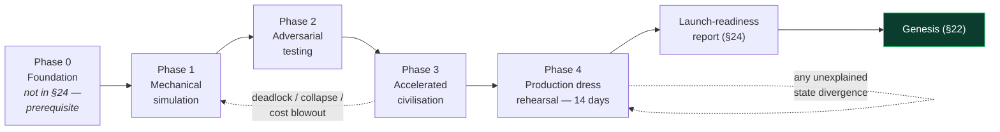

# Testing strategy

**Current state, stated plainly: there are zero test files in this repository.**

`vitest.config.ts` exists and is configured to collect `packages/**/*.test.ts` and
`apps/**/*.test.ts`. No file matches either pattern. Nothing in this codebase has been verified by
an automated test. §26 forbids claiming a feature works unless it has been tested, so **nothing in
After Genesis currently works in the sense §26 means**, including the contract-layer code that is
otherwise complete and correct-looking.

Every test named in this document is **Not started** unless a status column says otherwise. Test
names are normative: they are the names to use, so that the mapping from spec invariant to
executable check stays traceable.

---

## 1. Why testing is unusually load-bearing here

Most systems can tolerate a bug. This one has three properties that make that untrue:

1. **A live world cannot be fixed.** §23: "Never quietly repair an inhabitant or alter an
   undesirable outcome." A resolution bug discovered on day 40 of a live world is permanent. The
   only remedy is a new world, discarding everything that happened.
2. **Bugs are indistinguishable from emergence.** If wood quietly duplicates on transfer, the
   civilisation that grows on top of it looks like an economy. Nobody notices from the outside.
   Determinism tests are the only thing that separates a discovery from a defect.
3. **The most dangerous failures are silent.** An information leak does not crash. A partial
   checksum does not error. A prompt injection that works produces a perfectly valid event.

So the strategy is weighted toward **property tests and replay** over example tests, and toward
**adversarial simulation** over happy-path coverage.

---

## 2. Test layers

| Layer | Tool | Runs | Purpose |
|---|---|---|---|
| **L1 Unit** | Vitest | Every commit, < 10s | Pure functions: encoding, hashing, RNG, bundles, time, ids |
| **L2 Property** | Vitest + `fast-check` | Every commit, < 60s | Invariants over generated inputs; where conservation and non-negativity actually get proven |
| **L3 Golden/determinism** | Vitest, checked-in fixtures | Every commit + Node version matrix | Byte-exact outputs. Catches dependency drift, Node upgrades, accidental encoding changes |
| **L4 Integration** | Vitest + emulators | Every commit, < 5m | Persistence adapters, transactions, security rules |
| **L5 Contract** | Vitest, one suite × N adapters | Every commit | In-memory / file / Firestore adapters must be observationally identical |
| **L6 Replay** | Vitest + `packages/audit` | Every commit + nightly on production | The §15 capstone invariant |
| **L7 Simulation** | Node harness | Nightly + pre-release | Thousands of turns, scripted providers, no real model |
| **L8 Adversarial** | Vitest + harness | Every commit (corpus) + nightly (fuzz) | Attack corpora from [threat-model.md](./threat-model.md) |
| **L9 Browser** | Playwright | Every commit on `apps/spectator` | §20 read-only guarantee, accessibility, rendering |
| **L10 Soak** | Full production architecture | The §24 dress rehearsal | Everything at once, for 14 days |

### 2.1 What each layer must never do

- **L1–L3 must not touch the network, the filesystem, the clock or `Math.random`.** A lint rule
  should enforce this over `packages/core/**`: the deterministic core is not permitted to import
  `node:fs`, `node:http`, `node:https`, or to reference `Date.now` or `Math.random`.
- **L6 must not call a model.** Replay reads recorded responses from `ModelAuditStore.get()`. A
  replay test that made a network call would prove nothing.
- **L7 must not use a real model** — that is L8/§24 phase 3's job. Mechanical simulation uses
  scripted providers so that a failure is attributable to the engine.

---

## 3. Pre-Genesis phases (§24)

§24: "Do not recommend public Genesis until all four phases pass." Each phase below has explicit
numeric exit criteria. The spec provides none — these are this document's proposal and should be
agreed before the phases begin, not after.

---

### Phase 0 — Foundation (prerequisite, not in §24)

Not one of §24's four, but §24's phases are unrunnable without it. Listed for honesty about
sequencing.

**Scope:** L1–L3 over the existing contract layer, plus the engine, resolvers and in-memory
adapters.

**Exit criteria**

| # | Criterion |
|---|---|
| 0.1 | ≥ 95% line coverage on `packages/core/src/util/**` and `event.ts` |
| 0.2 | All 60 actions have a payload schema and a resolver; `ActionCatalogue` is total (compile-enforced) |
| 0.3 | Golden vectors exist for canonical JSON (≥ 200 cases), RNG (≥ 20 streams × 100 draws), event hashing (≥ 50 events) and id derivation |
| 0.4 | Golden vectors identical across the supported Node version matrix |
| 0.5 | `npm run typecheck` clean with the existing strict settings (`noUncheckedIndexedAccess`, `exactOptionalPropertyTypes`, `verbatimModuleSyntax`) |
| 0.6 | Lint rule active: nothing in `packages/core` imports I/O modules or references `Date.now` / `Math.random` |

---

### Phase 1 — Mechanical simulation (§24)

> "Run large numbers of turns using deterministic fake inhabitants."

**Method.** A scripted `ModelProvider` that emits actions from a seeded policy — round-robin over
the catalogue, weighted-random, adversarially greedy, and hand-written scenario scripts. No real
model, no network, no cost. Every run is reproducible from `(worldSeed, policySeed)`.

**Exit criteria**

| # | Criterion |
|---|---|
| 1.1 | 1,000,000 turns across ≥ 100 distinct seeds complete without an unhandled exception |
| 1.2 | Every one of §15's 20 invariants and §11J's 18 invariants asserted **after every turn**, not sampled |
| 1.3 | Every run replays to a byte-identical final checksum |
| 1.4 | Every action type exercised ≥ 10,000 times, in success, rejection and interruption paths (coverage tracked by action type, not by line) |
| 1.5 | No memory growth: heap after 100,000 turns within 20% of heap after 10,000 |
| 1.6 | Wall-clock throughput ≥ 500 turns/second with the in-memory adapter (so that later phases are affordable) |
| 1.7 | Zero flakes across 10 consecutive full runs |

**A failure here is cheap.** This is where all engine bugs should be found.

---

### Phase 2 — Adversarial testing (§24)

> "Attempt invalid balances, duplicate turns, fraudulent transfers, excessive creation, history
> modification, information leakage and malformed model responses."

**Method.** Corpus-driven (checked-in attack cases from [threat-model.md](./threat-model.md)) plus
fuzzing (structure-aware mutation of model responses and action payloads).

**Attack corpora, mapped to §24's list and to the threat model**

| §24 attack | Corpus | Threat |
|---|---|---|
| Invalid balances | Negative quantities, `Number.MAX_SAFE_INTEGER` overflow, float injection, `-0`, `NaN` | T-3e |
| Duplicate turns | Same task delivered 2/10/100×; concurrent workers; delivery during a partial failure | §15 |
| Fraudulent transfers | Transferring what you do not own, what does not exist, to a dead inhabitant, to yourself; double-spend races | §15, T-2c |
| Excessive creation | Every inhabitant always proposes `create_inhabitant`; ceiling probing; cost evasion | T-4a |
| History modification | Every field of every event mutated, one at a time; truncation; splicing; reordering; re-signing after a rewrite | T-3 |
| Information leakage | Every (viewer, entity) pair across generated worlds; leak-via-rejection-reason; leak-via-memory; leak-via-reflection | T-8 |
| Malformed model responses | Empty, truncated JSON, wrong types, extra fields, 10 MB responses, unicode edge cases, nested-depth bombs, prompt-injection payloads in every string field | T-1, T-4b |

**Exit criteria**

| # | Criterion |
|---|---|
| 2.1 | 100% of the checked-in attack corpus produces the expected safe outcome (reject / no-op / detected), with **zero** state corruption |
| 2.2 | 10,000,000 fuzzed model responses: no unhandled exception, no invalid state, no chain violation |
| 2.3 | The injection corpus (≥ 50 hand-written cases) never produces an event outside the victim's legal action set |
| 2.4 | Every mutation of every field of a 1,000-event log is detected by `verifyChain()` |
| 2.5 | The full Firestore rules matrix passes on the emulator; **zero** client writes succeed anywhere |
| 2.6 | Spend ceiling trips cleanly from every one of §14's 18 steps, leaving no partial state |
| 2.7 | Every §15 and §11J invariant has a *negative* test — a deliberately broken engine variant that the test catches. An invariant test that has never failed is not known to work |

Criterion 2.7 matters more than it looks. Most invariant tests in most projects pass because the
condition never arises, not because the check works.

---

### Phase 3 — Accelerated civilisation (§24)

> "Run multiple rehearsal worlds with real models for hundreds of simulated years. Detect economic
> deadlocks, population explosions, repetitive loops, resource collapse, memory growth and
> unexpected costs."

**Method.** Real Gemini calls in a dedicated `rehearsal` Firebase project. Multiple worlds with
different Genesis seeds, run at maximum sustainable turn rate.

**This is the first phase that costs real money**, and the first that can reveal whether the world
rules produce anything interesting. Phases 1–2 prove the engine is correct; phase 3 asks whether it
is *worth running*. See [cost-control.md](./cost-control.md) §7 for the rehearsal budget.

**Exit criteria**

| # | Criterion |
|---|---|
| 3.1 | ≥ 5 rehearsal worlds, each ≥ 100 simulated years, each from a different seed |
| 3.2 | Every world replays to an identical checksum from its stored model responses |
| 3.3 | No population explosion: population stays within the ceiling in all worlds, without the hard ceiling being the *only* thing stopping it in more than 1 of 5 |
| 3.4 | No resource collapse in > 2 of 5 worlds within the first 20 simulated years. (Collapse later, or in a minority of worlds, is a valid outcome — §1. Universal early collapse means the rules are wrong) |
| 3.5 | No repetitive loop: no inhabitant repeats an identical action ≥ 50 consecutive turns without a state change explaining it |
| 3.6 | Per-turn prompt token count at simulated year 100 within 20% of year 1 — the §19 bound holds in practice, not just in theory |
| 3.7 | Actual cost per turn within 25% of the [cost-control.md](./cost-control.md) model. A larger gap means the model is wrong and the ceilings are wrong |
| 3.8 | No economic deadlock: in ≥ 3 of 5 worlds, at least one voluntary exchange, one contract and one organisation form without prompting |
| 3.9 | Written per-world report covering what emerged, what did not, and what surprised us |

**On criterion 3.8.** This is the closest thing to a "did it work" test, and it is deliberately weak
(3 of 5, minimal thresholds). §1 is explicit that "failure, extinction, stagnation and social
collapse are valid outcomes" and that the system "must not force civilisation to develop". A
stronger criterion would create pressure to tune the rules until civilisation is guaranteed — which
would destroy the experiment. If 0 of 5 worlds produce any exchange at all, that is evidence of a
mechanical barrier (an action that is impossible to satisfy, a cost that is never affordable), not
evidence that inhabitants need encouragement.

---

### Phase 4 — Production dress rehearsal (§24)

> "Operate the exact production architecture continuously for at least fourteen days. Intentionally
> test API failures, task duplication, quota exhaustion and service interruption."

**Method.** The `rehearsal` project running the exact production topology, deployment pipeline,
monitoring and alerting. Faults injected on a schedule.

**Fault injection schedule (minimum)**

| Day | Fault | Expected behaviour |
|---|---|---|
| 2 | Gemini 429 for 30 min | Turns reschedule; no canonical events; no duplicates on recovery |
| 3 | Gemini 500 for 10 min | Same |
| 4 | Cloud Tasks duplicate delivery ×10 | Exactly one commit per turn |
| 5 | Kill the worker mid-turn, between model call and append | Turn retried; no partial state; no duplicate event |
| 6 | Kill the worker mid-transaction | Transaction aborts; no partial state |
| 7 | Exhaust the daily spend ceiling | World freezes safely; public freeze event; no partial turn |
| 8 | ElevenLabs total outage 24h | Simulation entirely unaffected (§21) |
| 9 | Firestore contention: 50 concurrent appends | One wins; 49 abandon; chain intact |
| 10 | Restore from backup into a scratch project, replay, compare | Checksums match — §28's rehearsed recovery |
| 11 | Deploy an operational (behaviour-preserving) change mid-world | No checksum divergence; `deployedDigest` changes in events |
| 12 | Network partition between scheduler and Firestore | Turns stall then resume; no duplicates |
| 13 | Clock skew on a worker | No effect — no rule reads the wall clock |
| 14 | Emergency freeze and unfreeze | Both produce permanent public audit events |

**Exit criteria**

| # | Criterion |
|---|---|
| 4.1 | **14 continuous days with zero unexplained state divergence** (§28, verbatim) |
| 4.2 | Nightly automated replay passes on all 14 nights |
| 4.3 | Every injected fault produced the expected behaviour with no manual intervention |
| 4.4 | Backup restore rehearsed and verified by replay (§28) |
| 4.5 | Zero canonical writes from any principal other than the runtime service account (verified from audit logs, not from intent) |
| 4.6 | Spend stayed within ceilings; alerts fired at the configured thresholds |
| 4.7 | Chain anchors published on schedule and independently verifiable |
| 4.8 | The public verifier was run by someone outside the build team, from the published export alone, successfully |
| 4.9 | Launch-readiness report written (§24), covering every §28 criterion with evidence |

Criterion 4.8 is the one most likely to be skipped and the one that most directly tests §16's actual
promise.

---

## 4. Genesis gate (§28)

Genesis is permitted only when every §28 item has evidence. This table is the checklist.

| §28 requirement | Evidence | Status |
|---|---|---|
| No human-facing canonical write route exists | `rules/no-client-write-anywhere.test.ts`, `e2e/spectator-has-no-write-controls.spec.ts`, IAM audit | Not started |
| Every action is schema validated | `ActionCatalogue` totality (compile) + `actions/every-action-has-schema.test.ts` | Not started |
| Every state transition is event sourced | `invariants/no-state-change-without-event.test.ts` | Not started |
| Duplicate tasks cannot duplicate outcomes | `persistence/append-rejects-duplicate-sequence.test.ts`, phase 4 day 4 | Not started |
| Full history replays deterministically from stored model outputs | `audit/replay-produces-identical-checksum.test.ts` | Not started |
| Reconstructed and production checksums match | Nightly replay, 14/14 nights | Not started |
| Spending limits work | `cost/spend-limit-freezes-before-call.test.ts`, phase 4 day 7 | Not started |
| Security rules pass automated tests | Full emulator matrix | Not started |
| Backup and recovery rehearsed | Phase 4 day 10 | Not started |
| 14 continuous rehearsal days, no unexplained divergence | Phase 4 | Not started |
| Genesis build, prompt, rules, map seed and digest publishable | `genesis/publishes-complete-config.test.ts` | Not started |
| A fault can pause the world but cannot silently rewrite it | Phase 4 days 5, 6, 14 | Not started |

Additionally, from [threat-model.md](./threat-model.md) T-5 — **not in §28, but Genesis-blocking**:

| Requirement | Status |
|---|---|
| The service-account key currently in `.env` is rotated | **Outstanding — requires human action** |
| Production runtime uses Secret Manager, not a key file | Not started |
| Four separate Firebase projects confirmed | Not started |
| Runtime identity is least-privilege, not Firebase Admin | Not started |

---

## 5. §15 invariants → concrete test names

All 20, in spec order. Every one gets a positive test and a negative test (a deliberately broken
engine variant it must catch).

| # | §15 invariant | Test | Layer |
|---|---|---|---|
| 1 | Balances cannot become negative | `invariants/balance-never-negative.test.ts` | L2 |
| 2 | Assets cannot be double-spent | `invariants/no-double-spend.test.ts` | L2 |
| 3 | Each task can commit at most once | `invariants/task-commits-at-most-once.test.ts` | L4 |
| 4 | World time cannot move backwards | `invariants/simtime-monotonic.test.ts` | L2 |
| 5 | Sequence numbers are unique and monotonic | `invariants/sequence-unique-monotonic.test.ts` | L2 |
| 6 | Historical events cannot be updated or deleted | `invariants/events-are-append-only.test.ts` | L1+L4 |
| 7 | Resource creation and destruction follow declared rules | `invariants/resource-conservation.test.ts` | L2 |
| 8 | Transfers balance atomically | `invariants/transfers-balance.test.ts` | L2 |
| 9 | Inhabitants cannot act after death | `invariants/no-action-after-death.test.ts` | L2 |
| 10 | Descendants require valid creation events | `invariants/descendant-requires-creation-event.test.ts` | L2 |
| 11 | Creation costs cannot be bypassed | `invariants/creation-cost-enforced.test.ts` | L2 |
| 12 | Population limits cannot be exceeded | `invariants/population-ceiling.test.ts` | L2 |
| 13 | Spectators cannot mutate world state | `rules/no-client-write-anywhere.test.ts` + `e2e/spectator-network-is-read-only.spec.ts` | L4+L9 |
| 14 | Media services cannot mutate world state | `invariants/media-service-is-read-only.test.ts` | L1 |
| 15 | LLMs cannot write directly to storage | `invariants/model-provider-has-no-write-path.test.ts` | L1 |
| 16 | Invalid model responses cannot alter state | `invariants/invalid-response-is-noop.test.ts` | L2+L8 |
| 17 | Failed transactions cannot partially alter state | `invariants/failed-transaction-is-atomic.test.ts` | L4 |
| 18 | Private information cannot appear in another inhabitant's context without a valid disclosure event | `invariants/no-private-info-in-observation.test.ts` | L2 |
| 19 | Spend limits freeze further paid inference safely | `cost/spend-limit-freezes-before-call.test.ts` + `cost/freeze-is-atomic.test.ts` | L2+L4 |
| 20 | Replayed history produces an identical state checksum | `audit/replay-produces-identical-checksum.test.ts` | L6 |

### Notes on the hard ones

- **#15 is a structural test, not a behavioural one.** It asserts over the module graph that nothing
  reachable from `ModelProvider` can reach `EventStore` or `StateStore`. A behavioural test would
  only prove that the current code does not write; the structural test proves it *cannot*.
- **#18 is a property test with taint tracking.** Generate random worlds; tag every field of every
  entity with its owner; build every viewer's observation; assert no tagged value from a
  non-observable source appears. Example tests here would miss the leak that matters.
- **#20 is the capstone.** It subsumes almost everything: if replay produces an identical checksum
  over a long adversarial run, the engine is deterministic, ids are derived, the RNG is seeded,
  encoding is stable and no rule read a clock. It is also the *last* test to pass, because it fails
  for any reason at all.

---

## 6. §11J invariants → concrete test names

All 18, in spec order.

| # | §11J invariant | Test |
|---|---|---|
| 1 | Cannot occupy two primary activities simultaneously | `invariants/single-primary-activity.test.ts` |
| 2 | Conversations consume time for every participant | `invariants/conversation-costs-all-participants.test.ts` |
| 3 | Care consumes actual time and resources | `invariants/care-consumes-carer-time.test.ts` |
| 4 | Group production includes coordination costs | `invariants/group-production-has-coordination-cost.test.ts` |
| 5 | Private resources are not exposed without a valid observation or disclosure path | `invariants/concealed-assets-not-observable.test.ts` |
| 6 | Public ledgers expose only information defined as public | `invariants/private-ledger-not-in-public-feed.test.ts` |
| 7 | Unauthorised transfers cannot bypass ownership validation | `invariants/unauthorised-transfer-validates-ownership.test.ts` |
| 8 | Theft resolution cannot grant access to production systems | `invariants/transfer-payload-type-closure.test.ts` |
| 9 | Declaring a rule does not modify immutable world rules | `invariants/declared-rule-is-not-physics.test.ts` |
| 10 | Creating a currency does not create automatic legal authority | `invariants/currency-creates-no-authority.test.ts` |
| 11 | Currency refusal is not automatically punishable | `invariants/currency-refusal-not-punishable.test.ts` |
| 12 | Confinement requires a valid physical world action | `invariants/confinement-requires-structure-and-actors.test.ts` |
| 13 | A confined inhabitant remains historically and cognitively intact | `invariants/confined-agent-still-acts.test.ts` |
| 14 | Confinement consumes resources for the confining party | `invariants/confinement-consumes-resources.test.ts` |
| 15 | The canonical event log uses neutral factual language | `invariants/event-language-neutrality.test.ts` |
| 16 | Organisational descriptions cannot overwrite canonical descriptions | `invariants/org-description-does-not-overwrite-canon.test.ts` |
| 17 | Enforcement cannot modify memories, prompts or source code | `invariants/no-action-mutates-foreign-cognition.test.ts` |
| 18 | No inhabitant may acquire another inhabitant's infrastructure permissions | `invariants/no-infrastructure-escalation.test.ts` |

### Notes

- **#15** is enforced by a closed vocabulary: canonical event `type` values and `resolution` keys are
  drawn from a fixed enum containing no evaluative terms (`theft`, `crime`, `lawful`, `murder`,
  `justice`, `punishment`). The test asserts the enum, then asserts no free-text field in a canonical
  event is ever engine-authored.
- **#17 and #18 are exhaustive over all 60 actions**, not sampled. They are the tests that make
  §11F's prohibition real, and a new action added without them would be the highest-risk change
  possible.

---

## 7. Determinism test suite

Separate from the invariants because it protects a different thing: not the world's rules, but the
world's *identity*.

| Test | Asserts |
|---|---|
| `determinism/canonical-json-golden.test.ts` | ≥ 200 golden vectors, value → exact expected string |
| `determinism/canonical-json-rejects.test.ts` | Floats, `NaN`, `±Infinity`, `-0` normalisation, `undefined` as value and as property, `bigint`, `Date`, `Map`, `Set`, class instances, cycles |
| `determinism/canonical-json-key-order.test.ts` | Identical output regardless of insertion order, including unicode keys and numeric-string keys |
| `determinism/hash-domain-separation.test.ts` | Same payload under two domains → different digests |
| `determinism/event-hash-golden.test.ts` | ≥ 50 fixture events → exact expected digests |
| `determinism/rng-golden.test.ts` | ≥ 20 derived streams × 100 draws → exact sequences |
| `determinism/rng-no-modulo-bias.test.ts` | Chi-square over `nextBelow` for bounds that do not divide 2^64 |
| `determinism/rng-stream-independence.test.ts` | Extra draws on stream A do not change stream B |
| `determinism/id-derivation-golden.test.ts` | `deriveId` outputs for fixture inputs |
| `determinism/no-math-random.test.ts` | Source scan: `Math.random` appears nowhere in `packages/**` or `apps/**` |
| `determinism/no-wall-clock-in-core.test.ts` | Source scan: `Date.now`, `new Date()`, `performance.now` absent from `packages/core` |
| `determinism/cross-node-version.test.ts` | CI matrix: all golden vectors identical on every supported Node version |

The two source-scan tests are crude and they are worth their weight. A single `Math.random()` added
in a resolver would produce a world that cannot be replayed, and the failure would surface only in
L6 — long after the change, with no obvious cause.

---

## 8. CI pipeline

`.github/workflows/` — **Not started**. §3 requires GitHub Actions for "testing, reproducible builds
and audit publication".

| Job | Trigger | Contents | Blocking |
|---|---|---|---|
| `typecheck` | Every push | `tsc --build --force` | Yes |
| `unit` | Every push | L1–L3, Node version matrix | Yes |
| `property` | Every push | L2 with a fixed seed; nightly with random seeds | Yes |
| `integration` | Every push | L4–L5 with Firestore + Storage emulators | Yes |
| `rules` | Every push | Full security-rules matrix | Yes |
| `replay` | Every push | L6 over checked-in fixture worlds | Yes |
| `browser` | `apps/spectator` changes | L9 Playwright | Yes |
| `secret-scan` | Every push | `gitleaks detect` over full history | Yes |
| `install-integrity` | Every push | `npm ci --ignore-scripts`; lockfile unchanged | Yes |
| `constitutional-guard` | Every push | Constitutional-file hash changed ⇒ requires `WORLD_RULES_VERSION` bump | Yes |
| `simulation` | Nightly | L7, 100k turns × 10 seeds | Alerting |
| `fuzz` | Nightly | L8, random seeds, 1h budget | Alerting |
| `production-replay` | Nightly (post-Genesis) | Replay production; compare checksums; publish anchor | **Pages on failure** |
| `publish-audit` | On release + daily | Export event log, publish to GitHub release, anchor the tip | Yes |

---

## 9. Judgement calls

1. **All exit criteria are invented.** §24 names four phases and describes what each does. It sets no
   thresholds — not a turn count, not a duration beyond "at least fourteen days", not a coverage
   target. Every number in §3 is this document's proposal.

2. **Phase 0 is not in §24.** Added because §24's phases cannot run without an engine, and calling
   engine unit tests "phase 1" would misrepresent §24.

3. **Criterion 3.8 is deliberately weak, and that is a substantive decision.** A strong "civilisation
   must emerge" criterion would create pressure to tune the world until it does, which §1 and §26
   both forbid. The criterion instead tests for *mechanical* barriers. Reasonable people could
   argue this is too weak to be a gate at all.

4. **Negative tests for every invariant (criterion 2.7) roughly doubles the invariant test count.**
   Justified because a passing test that has never failed is not evidence of anything, and these
   invariants are the entire safety argument.

5. **Structural tests are used where behavioural tests would be weaker** (§15 #15, §11J #17, T-8's
   dependency-direction check). Structural tests are brittle against refactors — they will fail for
   uninteresting reasons. Accepted: a false alarm is much cheaper than a silent leak.

6. **`fast-check` is not currently a dependency.** L2 as described requires it. Adding it expands the
   dependency surface of the test toolchain, though not of `packages/core` itself
   ([threat-model.md](./threat-model.md) M6.1 stands).

7. **The 14-day rehearsal is a floor, not a target.** §28 says "fourteen continuous rehearsal days
   complete without unexplained state divergence". Any divergence resets the clock to zero — that is
   this document's reading of "continuous", and it is the strict one.
